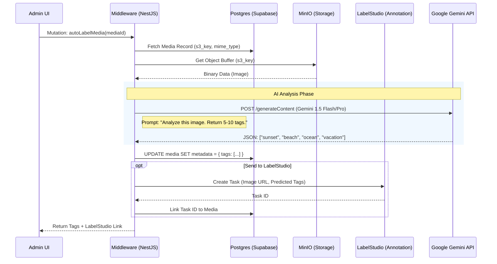
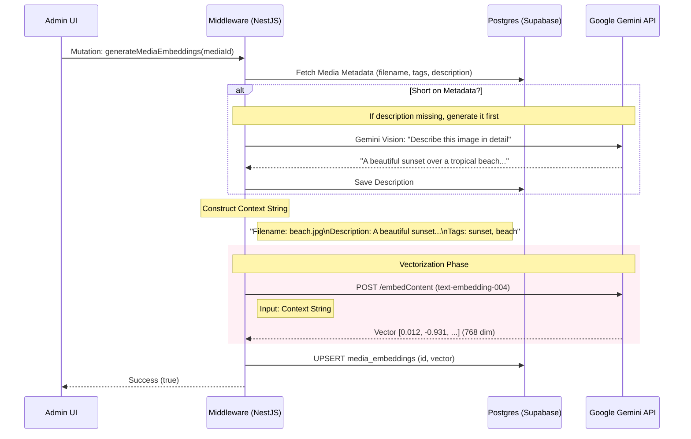

# AI Architecture: Labeling & Embeddings

This document outlines the architecture and data flow for the AI features in the Nusantarasoft Media CMS.

## 1. System Overview

The system uses a **Retrieval-Augmented Generation (RAG)** pattern where:
1.  **Media Assets** are stored in **MinIO** (S3 compatible).
2.  **Metadata** (Tags, Description) is generated by **Google Gemini 1.5 Flash**.
3.  **Embeddings** (Vectors) are generated by **Google Gemini Text Embedding 004**.
4.  **Vectors** are stored in **PostgreSQL (pgvector)** via Supabase.
5.  **Search** performs cosine similarity on these vectors.

## 2. Data Flow Diagrams

### A. Auto-Labeling Flow (Generate Tags)

Triggers when a user uploads a file with "Auto Label" checked, or clicks "Auto Label" in the UI.

### B. Embedding Generation Flow (RAG Indexing)

Triggers when a user clicks "Generate Embeddings" or automatically after upload.

## 3. Component Details

### Middleware (`RagService`)
- **Location**: `middleware/src/rag/rag.service.ts`
- **Responsibilities**:
    - Abstraction layer between App and AI Models.
    - Handles S3 file retrieval using `MinioClient`.
    - Manages fallback logic (API Key vs Service Account).
    - Formats text context for embedding.

### Database Schema
- **`media` table**: Stores metadata (`jsonb`), description, tags.
- **`media_embeddings` table**: Stores the vector (`vector(768)`).
    - Uses `pgvector` extension.
    - Linked to `media.id`.

### AI Models Used
- **Vision/Labeling**: `gemini-1.5-flash` (Fast, cost-effective multimodal analysis).
- **Embedding**: `text-embedding-004` (High performance, 768 dimensions).
