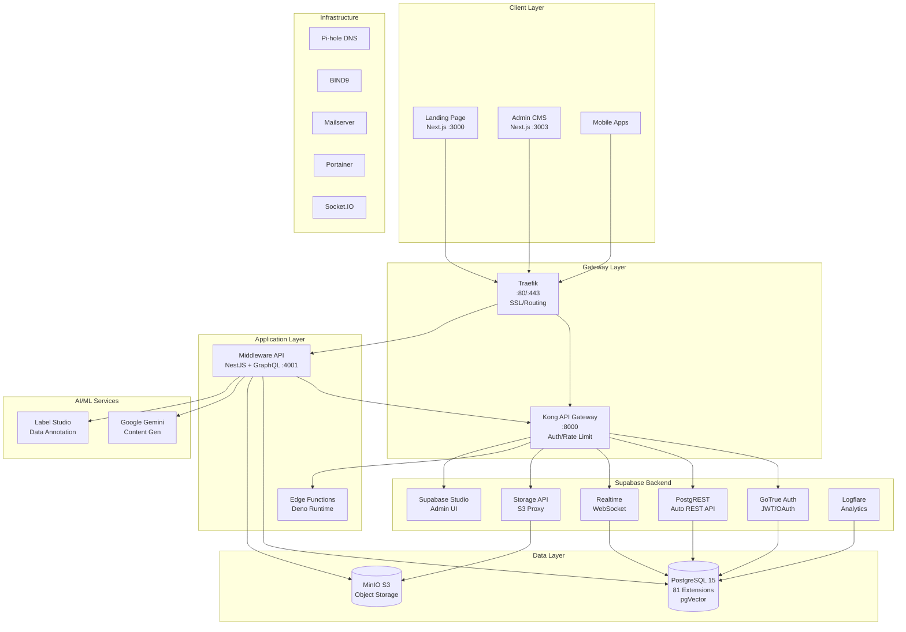
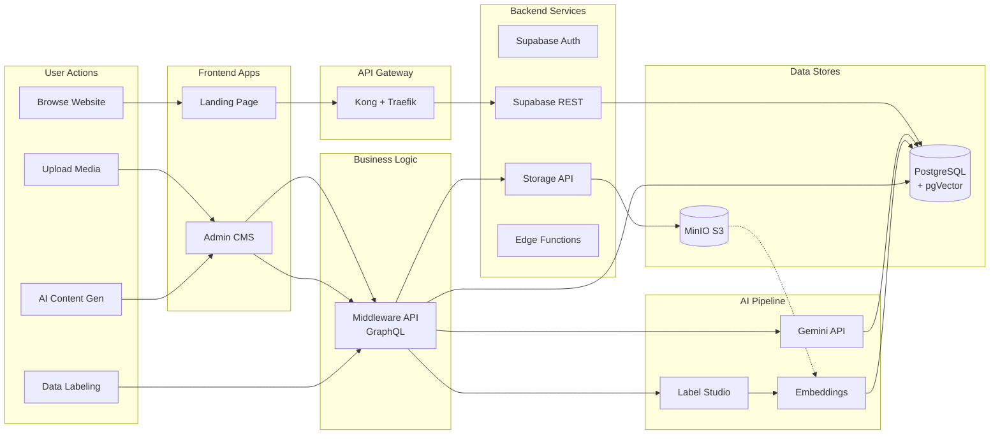
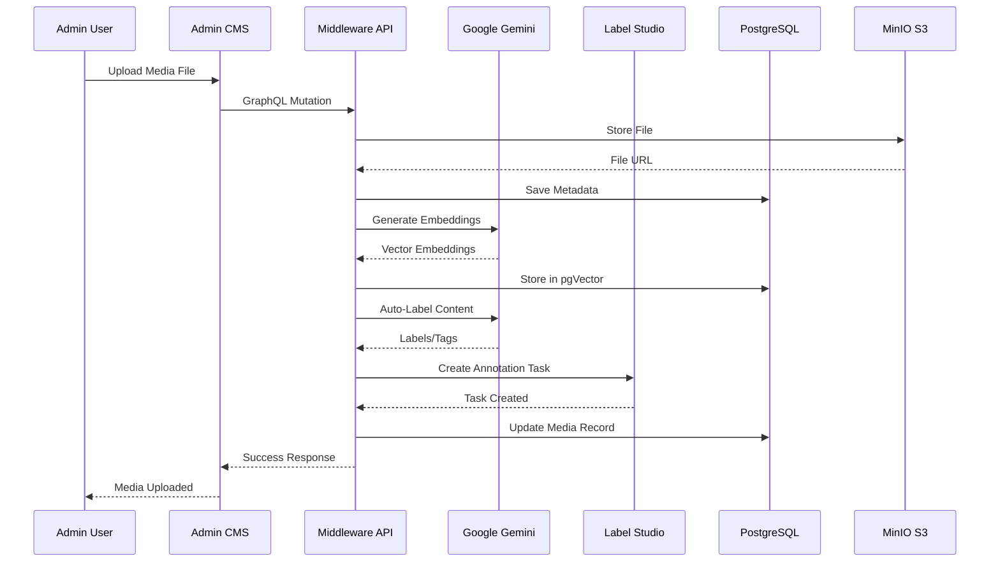
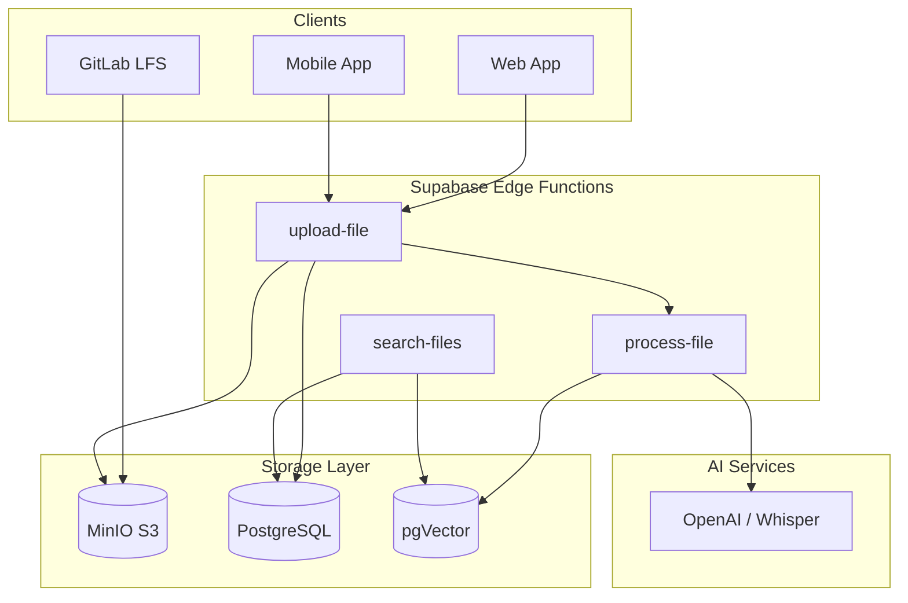

# Nusantarasoft Docker Infrastructure

Complete enterprise infrastructure with 11 integrated stacks and 65+ services. **v2.16.0**

---

## 🏗️ Architecture Overview

### High-Level System Architecture



---

### Data Flow Diagram



---

### CMS & AI Data Flow



---

### Service Stacks Overview

| Stack | Services | Ports | Purpose |
|-------|----------|-------|---------|
| **Data & Storage** | MinIO, PostgreSQL, pgAdmin | 9000, 9001, 5432 | Object storage, RDBMS |
| **Supabase** | Kong, Auth, REST, Realtime, Storage, Studio | 8000, 4000 | Backend-as-a-Service |
| **CMS & AI** | Admin, Middleware, Label Studio, RAGFlow | 3003, 4001, 8080 | Content management + AI |
| **Big Data** | Dremio, Nessie, MinIO (Lakehouse) | 9047 | Lakehouse analytics |
| **Frontend** | Landing Page | 3000 | Public website |
| **Infrastructure** | Traefik, NPM, Pi-hole, BIND9, Portainer | 80, 443, 8081 | Proxy, DNS, monitoring |
| **Email** | Mailserver, Roundcube | 25, 465, 587, 993 | Email infrastructure |
| **Real-time** | Socket.IO, Realtime | 3002 | WebSocket communication |

---

### Technology Stack

```
┌─────────────────────────────────────────────────────────────────┐
│                        CLIENT LAYER                             │
├─────────────────────────────────────────────────────────────────┤
│  Landing Page (Next.js)  │  Admin CMS (Next.js + PrimeReact)   │
├─────────────────────────────────────────────────────────────────┤
│                       GATEWAY LAYER                             │
├─────────────────────────────────────────────────────────────────┤
│          Traefik (Reverse Proxy)  │  Kong (API Gateway)        │
├─────────────────────────────────────────────────────────────────┤
│                     APPLICATION LAYER                           │
├─────────────────────────────────────────────────────────────────┤
│  Middleware (NestJS + GraphQL)  │  Edge Functions (Deno)       │
├─────────────────────────────────────────────────────────────────┤
│                      BACKEND LAYER                              │
├─────────────────────────────────────────────────────────────────┤
│  Auth (GoTrue)  │  REST (PostgREST)  │  Storage  │  Realtime   │
├─────────────────────────────────────────────────────────────────┤
│                        DATA LAYER                               │
├─────────────────────────────────────────────────────────────────┤
│  PostgreSQL 15 (pgVector, 81 extensions)  │  MinIO S3          │
├─────────────────────────────────────────────────────────────────┤
│                       AI/ML LAYER                               │
├─────────────────────────────────────────────────────────────────┤
│  Google Gemini (Embeddings, Generation)  │  Label Studio       │
└─────────────────────────────────────────────────────────────────┘
```

---

### Directory Structure

```
nusantarasoft/
├── admin/                 # Next.js Admin CMS Dashboard
│   └── src/
│       ├── app/admin/     # App Router pages (176+ routes)
│       │   ├── dashboard/ # Main dashboard
│       │   ├── news/      # News & Media Intelligence (8 pages)
│       │   ├── audit/     # Audit & Compliance (3 pages)
│       │   ├── datasets/  # Big Data / Dremio
│       │   ├── crm/       # CRM Intelligence
│       │   ├── accounting/# Accounting Suite
│       │   ├── hr/        # HR Management
│       │   └── ...        # +15 more module groups
│       ├── components/    # 500+ React components
│       ├── hooks/         # Custom React hooks
│       └── lib/           # GraphQL client, services, exportUtils
├── middleware/            # NestJS GraphQL API Server
│   └── src/
│       ├── auth/          # Authentication resolvers
│       ├── media/         # Media management module
│       ├── news/          # News Intelligence (crawler, sentiment)
│       ├── dremio/        # Big Data integration
│       ├── accounting/    # Accounting backend
│       ├── rag/           # RAG/AI integration
│       ├── pages/         # CMS pages module
│       └── webhooks/      # Label Studio webhooks
├── landing-page/          # Next.js Public Website
│   └── src/
│       ├── app/           # App Router pages
│       └── components/    # UI components
├── volumes/               # Docker persistent data & configs
│   ├── db/                # PostgreSQL init scripts
│   │   └── news_intelligence.sql # News module migration (16 tables)
│   ├── functions/         # Supabase Edge Functions
│   ├── api/               # Kong configuration
│   └── bind9/             # DNS zone files
├── docker-compose.yml     # Main orchestration (30+ services)
├── docker-compose.full.yml# Full stack (65+ services)
└── .env                   # Environment variables
```

---

## 💻 System Requirements

| Component | Minimum | Recommended |
|-----------|---------|-------------|
| **CPU** | 8 cores | 16+ cores |
| **RAM** | 32 GB | 64+ GB |
| **Storage** | 100 GB SSD | 500+ GB NVMe |
| **Docker** | 24.0+ | Latest |
| **Docker Compose** | 2.20+ | Latest |
| **OS** | Windows 10/11, Ubuntu 22.04, macOS 13+ | - |

> ⚠️ **Note**: Running all 65+ services simultaneously requires significant resources. For limited hardware, start only the stacks you need.

## 🚀 Quick Start

```bash
docker compose up -d      # Start all services
docker compose down       # Stop all services
docker compose down -v    # Destroy all (including data)
```

## 🎯 Selective Startup (Recommended)

Run only the stacks you need to save resources:

### Core Services (Always Required)
```bash
# Start essential infrastructure first
docker compose up -d openldap phpldapadmin nginx-proxy-manager traefik portainer
```

### Start by Stack
```bash
# 1. Data & Analytics
docker compose up -d minio postgres pgadmin dremio superset nessie anythingllm

# 2. Supabase (Backend)
docker compose up -d supabase-db supabase-studio kong supabase-auth supabase-rest supabase-realtime supabase-storage

# 3. Workflow & Automation
docker compose up -d n8n jenkins awx awx-redis socketio

# 4. Infrastructure & DNS
docker compose up -d openldap phpldapadmin nginxproxymanager pihole bind9

# 5. Email Server
docker compose up -d mailserver roundcube

# 6. Management & Monitoring
docker compose up -d portainer zabbix-server zabbix-web k3s

# 7. Observability
docker compose up -d prometheus grafana loki promtail

# 8. Security & Identity
docker compose up -d keycloak vault crowdsec

# 9. Collaboration
docker compose up -d mattermost nextcloud jitsi-web

# 10. DevOps
docker compose up -d gitlab registry sonarqube

# 11. Messaging & API
docker compose up -d zookeeper kafka kafka-ui rabbitmq hasura
```

### Quick Profiles
```bash
# Minimal (Core only)
docker compose up -d postgres openldap nginxproxymanager portainer traefik

# Development Stack
docker compose up -d postgres pgadmin minio n8n gitlab sonarqube

# Full Stack (All services)
docker compose up -d
```

---

## 🔗 Access Links & Credentials

> 🔐 **Configuration**: All credentials below are default values defined in `.env`. Change them there for security.

### 1. Data & Analytics
| Service | URL | User | Password |
|---------|-----|------|----------|
| Minio | http://localhost:9001 | `supa-storage` | `secret1234` |
| Dremio | http://localhost:9047 | *(setup)* / `admin` | `secret1234` |
| Superset | http://localhost:8080 | `admin` | `admin` |
| AnythingLLM | http://localhost:3001 | *(setup)* | - |
| PgAdmin | http://localhost:8888 | `spygunsoft@gmail.com` | `password` |

### 2. Supabase
| Service | URL | User | Password |
|---------|-----|------|----------|
| Studio | http://localhost:8000 | *(JWT auth)* | - |
| Kong API | http://localhost:8000 | *(ANON_KEY / SERVICE_ROLE_KEY)* | - |
| Analytics | http://localhost:4000 | - | - |

### 3. Workflow & Automation
| Service | URL | User | Password |
|---------|-----|------|----------|
| n8n | http://localhost:5678 | `spygunsoft@gmail.com` | `N8n@Nusantara2024!` |
| Jenkins | http://localhost:8084 | `admin` | *(from logs)* |
| AWX | http://localhost:8085 | `admin` | `Nusantarasoft123!` |

### 4. Infrastructure & DNS
| Service | URL | User | Password |
|---------|-----|------|----------|
| Pi-hole | http://localhost:8053/admin | - | `Nusantarasoft123!` |
| BIND9 Webmin | http://localhost:10000 | `root` | `Nusantarasoft123!` |
| phpLDAPadmin | http://localhost:8089 | `cn=admin,dc=nusantarasoft,dc=local` | `Nusantarasoft123!` |
| Nginx PM | http://localhost:8081 | `admin@example.com` | `changeme` |

### 5. Email Server
| Service | URL | User | Password |
|---------|-----|------|----------|
| Roundcube Webmail | http://localhost:8082 | *(email)* | - |
| Mailserver SMTP | localhost:25, 465, 587 | - | - |
| Mailserver IMAP | localhost:993 | - | - |

> **Add users**: `docker exec -it mailserver setup email add user@nusantarasoft.local`

### 6. Management & Monitoring
| Service | URL | User | Password |
|---------|-----|------|----------|
| Portainer | http://localhost:9090 | *(setup)* | - |
| Zabbix | http://localhost:8086 | `Admin` | `zabbix` |
| K3s API | https://localhost:6443 | *(kubeconfig)* | - |

### 7. Observability
| Service | URL | User | Password |
|---------|-----|------|----------|
| Grafana | http://localhost:3004 | `admin` | `Nusantarasoft123!` |
| Prometheus | http://localhost:9091 | - | - |
| Loki | http://localhost:3100 | - | - |

### 8. Security & Identity
| Service | URL | User | Password |
|---------|-----|------|----------|
| Keycloak | http://localhost:8180 | `admin` | `Nusantarasoft123!` |
| Vault | http://localhost:8200 | *(token)* | `vault-root-token-change-me` |
| CrowdSec | http://localhost:8083 | - | - |

### 9. Collaboration
| Service | URL | User | Password |
|---------|-----|------|----------|
| Mattermost | http://localhost:8065 | *(setup)* | - |
| Nextcloud | http://localhost:8090 | `admin` | `Nusantarasoft123!` |
| Jitsi | https://localhost:8443 | - | - |

### 10. DevOps
| Service | URL | User | Password |
|---------|-----|------|----------|
| GitLab | http://localhost:8929 | `root` | `Nusantarasoft123!` |
| Registry | http://localhost:5000 | - | - |
| SonarQube | http://localhost:9092 | `admin` | `admin` |

### 11. Messaging & API
| Service | URL | User | Password |
|---------|-----|------|----------|
| Kafka UI | http://localhost:8093 | - | - |
| RabbitMQ | http://localhost:15672 | `admin` | `Nusantarasoft123!` |
| Hasura | http://localhost:8094 | *(secret)* | `hasura_admin_secret_change_me` |

### 12. CMS & AI Stack
| Service | URL | Description |
|---------|-----|-------------|
| Admin CMS | http://localhost:3003 | Next.js Admin Dashboard with SpeedDial + MetaBalls |
| Middleware API | http://localhost:4001/graphql | NestJS GraphQL API with Gemini AI |
| Landing Page | http://localhost:3000 | Public website |

> **CMS Features**: PrimeReact SpeedDial for quick actions (AI Studio, Dark Mode, Settings), MetaBalls animation, Supabase Auth, MinIO file storage with pgVector semantic search

### 13. AI Data Labelling
| Service | URL | User | Password |
|---------|-----|------|----------|
| Label Studio | http://localhost:8080 | `admin@nusantarasoft.local` | `Nusantarasoft123!` |

---

## 🚀 Scripts

Helper scripts for common operations:

| Script | Description |
|--------|-------------|
| `scripts/pull-images.bat` | Pull all 65+ images in groups |
| `scripts/pull-minimal.bat` | Pull minimal infrastructure (21 images) |
| `scripts/start-minimal.bat` | Start minimal infrastructure |

### Minimal Infrastructure
```bash
.\scripts\pull-minimal.bat   # Pull images
.\scripts\start-minimal.bat  # Start services
```

**Includes**: **AI Middleware** (Gemini Auto-Label), **Supabase** (Auth, Storage, Realtime, REST), **DNS** (Pi-hole, BIND9), **Email** (Mailserver, Roundcube), **Infra** (Traefik, NPM, Portainer, Socket.IO)

---

## 🗄️ Database Credentials

All services use a **single PostgreSQL instance** with the following connection details:

### PostgreSQL Connection
| Property | Value |
|----------|-------|
| **Host** | `postgres` (Docker) / `localhost` (external) |
| **Port** | `5432` |
| **Username** | `supabase_admin` |
| **Password** | `Nusantarasoft123!` |

### Databases
| Service | Database Name |
|---------|---------------|
| **Main App/Supabase** | `nusantarasoft` |
| Supabase System | `_supabase` |
| Default PostgreSQL | `postgres` |
| NPM | `npm` |
| AWX | `awx` |
| Zabbix | `zabbix` |
| Keycloak | `keycloak` |
| Mattermost | `mattermost` |
| Nextcloud | `nextcloud` |
| SonarQube | `sonarqube` |

### Quick Connect Commands
```bash
# Connect via Docker (recommended)
docker exec -it postgres psql -U supabase_admin -d nusantarasoft

# Connect via psql (external)
psql -h localhost -p 5432 -U supabase_admin -d nusantarasoft
```

> **Note**: Supabase Studio connects to `nusantarasoft` database (set via `POSTGRES_DB` in `.env`)

### PostgreSQL Extensions (81 enabled)
| Category | Extensions |
|----------|------------|
| **AI/Vector** | `vector` |
| **Time-Series** | `timescaledb` |
| **Geospatial** | `postgis`, `postgis_raster`, `postgis_topology`, `postgis_sfcgal`, `postgis_tiger_geocoder`, `pgrouting`, `address_standardizer` |
| **Full-Text Search** | `pg_trgm`, `unaccent`, `rum`, `fuzzystrmatch`, `pgroonga`, `dict_int`, `dict_xsyn` |
| **Data Types** | `citext`, `hstore`, `ltree`, `cube`, `intarray`, `isn`, `seg`, `xml2` |
| **API & FDW** | `pg_graphql`, `pg_net`, `http`, `wrappers`, `dblink`, `postgres_fdw`, `file_fdw` |
| **Security** | `pgcrypto`, `pgjwt`, `supabase_vault`, `pgsodium`, `pgaudit`, `sslinfo` |
| **JavaScript** | `plv8`, `plcoffee`, `plls`, `plpgsql_check`, `pg_tle` |
| **Message Queue** | `pgmq` (in pgmq schema) |
| **Monitoring** | `pg_stat_monitor`, `pg_buffercache`, `hypopg`, `index_advisor`, `pgstattuple`, `pgrowlocks`, `pageinspect`, `amcheck` |
| **Utilities** | `tablefunc`, `earthdistance`, `pg_hashids`, `pgtap`, `btree_gin`, `btree_gist`, `bloom`, `pg_repack`, `pg_prewarm` |
| **Scheduling** | `pg_cron` (in postgres db only) |

> **Special Requirements:**
> - `pg_cron`: Must be installed in `postgres` database, not `nusantarasoft`
> - `pgmq`: Requires `pgmq` schema created first

### File Storage (S3 + pgVector + GitLab LFS)
A comprehensive storage solution leveraging MinIO S3 for files, PostgreSQL for metadata, and pgVector for AI-powered search. Integrated with GitLab for LFS.

**Architecture Diagram:**


**Tech Stack:**
- **Storage**: MinIO (S3 Compatible)
- **Database**: PostgreSQL 16 + pgVector (Metadata & Embeddings)
- **GitLab**: Configured to use MinIO for LFS, Artifacts, and Uploads
- **AI**: OpenAI (Embeddings), Whisper (Transcription)
- **Compute**: Supabase Edge Functions (Deno)

**Buckets:**
| Bucket | Content | Access | AI Processing |
|--------|---------|--------|---------------|
| `documents` | PDF, Docs | Private | Text Extraction + Embedding |
| `images` | Photos | Public | Captioning |
| `audio/video` | Media | Private | Transcription + Embedding |
| `gitlab-lfs` | Git Objects | Private | N/A |

**Key Features:**
- **Semantic Search**: Find files by meaning ("financial report Q1") instead of just keywords.
- **GitLab Integration**: Seamlessly store large Git objects in MinIO.
- **Automated Processing**: Files are automatically processed for text/embeddings on upload.
- **Hybrid Search**: Combines vector similarity with full-text search rankings.

See: [Platform Services Guide](docs/platform-services-guide.md)

---

## 📁 Directory Structure

```
├── docker-compose.yml           # Main compose file (65+ services)
├── docker-compose.production.yml # Production overrides
├── .env                         # Local environment
├── .env.production              # Production template
├── docs/
│   ├── platform-services-guide.md  # Email & File Storage guide
│   └── management-app-plan.md      # Tech stack management plan
├── scripts/
│   ├── pull-images.bat          # Pull all Docker images
│   ├── pull-minimal.bat         # Pull minimal stack images
│   └── start-minimal.bat        # Start minimal infrastructure
└── volumes/
    ├── api/                     # Kong config
    ├── db/                      # Database init scripts
    │   ├── extensions.sql       # 81 PostgreSQL extensions
    │   ├── emails.sql           # Email schema
    │   └── pg_cron.sql          # Scheduled jobs
    ├── functions/               # Supabase Edge functions
    ├── logs/                    # Vector config
    └── pooler/                  # Supavisor config
```

---

## 🚀 Production Deployment

For deploying to Ubuntu VPS with nusantarasoft.com domain:

```bash
# Use production config
docker compose -f docker-compose.yml -f docker-compose.production.yml up -d
```

See [`docs/email-deployment.md`](docs/email-deployment.md) for complete guide including:
- DNS configuration (MX, SPF, DKIM, DMARC)
- SSL/TLS setup
- DKIM key generation
- Troubleshooting

---

## 🔒 Security

> ⚠️ **Change all default passwords before production!**

---

## 📝 License

MIT

---

## 📋 Changelog

### v2.16.0 (2026-05-22)
- **Settings Gap Closure** — 2 new pages: SEO Configuration (meta tags, robots.txt, sitemap, Open Graph scoring, page-level overrides), Navigation Manager (menu trees, footer links, breadcrumbs, menu entry table)
- **AI Studio** — AnythingLLM workspace management (AI workspaces, document processor, embedding status, chat session analytics)
- **DevOps** — Docker Registry management (repositories, image tags, layer sizes, pull analytics)
- **Big Data** — 2 new pages: Nessie Catalog (branches, tables, version history, catalog entries), Dremio Lakehouse Admin (job analytics, reflections, source connections, query history)
- **Menu expansion** — +1 AI Studio sub-item (AnythingLLM), +1 DevOps sub-item (Docker Registry), +2 Big Data sub-items (Nessie Catalog, Dremio Admin)
- **Build verified**: 190+ pages, exit code 0

### v2.15.0 (2026-05-22)
- **Kong API Gateway Fix** — Resolved restart loop caused by Windows CRLF line endings in `kong-entrypoint.sh` and `kong.yml`. Bulk-converted 38 volume/script files to LF
- **`.gitattributes`** — Added global LF enforcement for `*.sh`, `*.yml`, `*.sql`, `*.exs`, `*.conf` to prevent future CRLF issues on Windows checkouts
- **Dremio Priority Completion (6/6)** — All items from `prioritas.md` resolved:
  - ✅ Edit Source modal (already complete)
  - ✅ Delete Source/VDS/Space from Datasets page — wired `onDeleteItem` handler through CatalogTree context menu
  - ✅ Data Sources page (`/admin/datasets/sources`) — standalone SourceManager with card grid, create/edit/delete
  - ✅ SQL pagination with offset/limit (already complete)
  - ✅ Cancel running job (already complete)
  - ✅ Edit VDS — new `EditVDSModal` with SQL editor, loads existing definition, submits via `updateVDS`
  - ✅ Rename Space — new `renameSpace` backend endpoint (service + resolver) + `RenameSpaceModal` UI
- **CatalogTree Context Menu** — Enhanced with Edit VDS, Rename Space actions alongside existing Delete actions
- **Menu expansion** — Added "Data Sources" entry under Big Data section
- **Build verified**: 184+ pages, exit code 0

### v2.14.0 (2026-05-20)
- **Reporting Engine** — 4 new pages: Dashboard (saved reports, recent exports), Report Builder (visual designer, data source/filter/chart config), Scheduled Reports (cron delivery, email recipients), Templates (8 pre-built module-specific report templates)
- **API Marketplace** — 3 new pages: Marketplace (12 categorized integrations with search/filter), Installed Integrations (connection status, request counts, uptime monitoring), Webhook Event Log (inbound/outbound events, delivery status, payload viewer)
- **Log Analytics** — 2 new pages: Log Analytics (log level distribution, top errors by severity, service heatmap), Platform Metrics (SLO compliance gauges, P95/P99 latency, Apdex scoring, endpoint performance)
- **Backend Integration** — New InfrastructureModule in middleware: system info, Portainer endpoints, MinIO server info via live API proxy with mock fallbacks
- **Production Hardening** — Nginx: HTTPS-ready config with security headers (HSTS, CSP, X-Frame-Options), landing page routing, WebSocket proxy, static asset caching. Docker: expanded `docker-compose.prod.yml` with logging rotation, memory limits, restart policies for all services
- **Deployment Scripts** — `scripts/generate-ssl.sh` (self-signed cert generator), `scripts/deploy.sh` (production deployment with rolling restart and health verification)
- **Landing Page** — Updated to v2.14.0, 3 new feature cards (Reporting, Integrations, Log Analytics), Architecture Showcase section with 18 open source tech badges, updated stats (185+ pages, 15 modules)
- **Menu expansion** — 3 new nav sections: Reports (4), Integrations (3), Analytics (2)
- **Build verified**: 185+ pages, exit code 0

### v2.13.0 (2025-05-17)
- **Management Stack** — 3 new pages: Portainer (endpoints, stacks, images, volumes), Zabbix (hosts, triggers, metrics, latest data), K3s Kubernetes (nodes, pods, services, namespaces)
- **Directory Services** — OpenLDAP dashboard (organizational units, user directory, group management)
- **API Layer** — Hasura GraphQL page (tracked tables, actions, event triggers, permissions)
- **AI Studio** — 2 new pages: Label Studio (annotation projects, task progress, recent labels), OpenClaw AI Gateway (agent registry, routing, health monitoring)
- **Realtime** — Socket.IO dashboard (namespaces, connected clients, rooms, event stats)
- **Big Data** — 2 new pages: Apache Superset BI (dashboards, charts, database connections), MinIO Storage (bucket browser, policies, server info)
- **Menu expansion** — AI Studio section (2 items), Big Data section (2 items), +4 Infrastructure sub-items, +1 Security sub-item, +1 Messaging sub-item
- **Build verified**: 176 pages, exit code 0

### v2.12.0 (2025-05-17)
- **Observability Stack** — 3 new pages: Grafana (dashboard browser, datasource health, alert rules), Prometheus (scrape targets, alert rules, metrics overview), Log Explorer (Loki streams, search, terminal log viewer)
- **Security & Identity** — 3 new pages: Keycloak SSO (realms, client apps, active sessions), Vault (secret engines, KV store, policies), CrowdSec (threat decisions, bouncers, parser stats)
- **Collaboration Tools** — 3 new pages: Mattermost (teams, channels, activity), Nextcloud (storage quotas, app management), Jitsi Meet (active rooms, participants, SRTP health)
- **DevOps Pipeline** — 2 new pages: GitLab (repos, CI/CD pipelines, container registry), SonarQube (quality gates, coverage, vulnerabilities)
- **Messaging & Events** — 2 new pages: Apache Kafka (topics, consumer groups, partition lag), RabbitMQ (queues, exchanges, message rates)
- **Email Administration** — Email server dashboard (domain security DKIM/SPF/DMARC, accounts, mail queue)
- **Multi-Tenancy** — Tenant management dashboard (tenant cards, quota management, feature flags, usage analytics)
- **Workflow Automation** — Unified automation dashboard (n8n workflows, Jenkins pipelines, AWX playbooks in tabbed view)
- **Infrastructure expansion** — 3 new sub-items: Grafana, Prometheus, Log Explorer
- **Menu expansion** — 8 new navigation sections: Security, Collaboration, DevOps, Messaging, Email, Tenants, Automation + 3 Infrastructure sub-items

### v2.11.0 (2025-05-12)
- **Audit & Compliance** — NEW module with 3 pages: Dashboard (compliance scoring, security checklist), Audit Logs (searchable/filterable trail), Data Retention (GDPR tools)
- **Payment Gateway** — E-Commerce payment provider config (Midtrans, Xendit, Stripe), transaction monitoring, revenue-by-method charts
- **Tax Configuration** — Indonesian PPh21 brackets, BPJS rates, PTKP table, THR settings under HR
- **Webhooks Manager** — Notification webhook CRUD, test ping, delivery log viewer, event subscriptions
- **API Gateway Monitor** — Kong routes, services, plugins, health checks, latency/RPS metrics
- **Dremio UI Wiring** — Context menu (delete VDS/space/source) on CatalogTree, SQL Runner cancel + pagination
- **Menu expansion** — 7 new navigation entries: Audit (3), Payments, Tax Config, Webhooks, API Gateway

### v2.10.0 (2025-05-11)
- **News & Media Intelligence** — 8-page module: Dashboard, Feed, Social Media, Web Crawler, Sentiment Analysis, Market Sounding, Content Publishing, Analytics & Reports
- **16-table database migration** (`news_intelligence.sql`) covering articles, crawlers, social media, sentiment, market signals, content drafts, calendar
- **Built-in Sentiment Engine** — keyword-based NLP scoring in NestJS middleware
- **RSS/Web Crawler** — native crawler with scheduled auto-crawl every 6 hours
- **Big Data enhancements** — Cancel job, Update/Delete VDS, Delete Space, SQL pagination
- **Docker Health dashboard** — live container status, CPU/memory bars, cluster overview
- **Enhanced Settings** — 7-tab config: General, SEO, Social, Email, Modules, Dremio, System Info
- **Menu expansion** — News & Intelligence section (8 items) + Docker Health sub-item

### v2.9.0 (2025-05-05)
- Notifications module (7 pages: inbox, channels, templates, rules, delivery logs, preferences, analytics)
- Glassmorphism standardization across all modules
- Export framework (PDF/Excel) across 35+ data pages

### v2.8.0
- CRM Intelligence, Accounting Suite, HR Management
- Ops Automation, Project Management, ITSM
- AI Studio (RAGFlow integration)
- Big Data / Dremio Lakehouse
