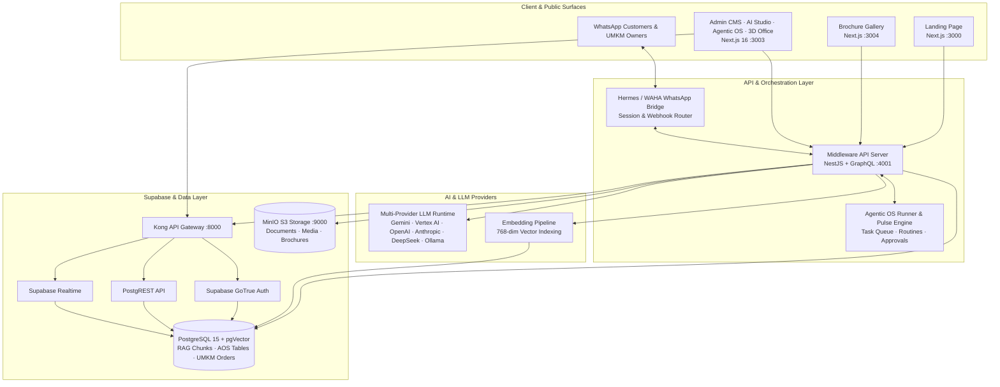
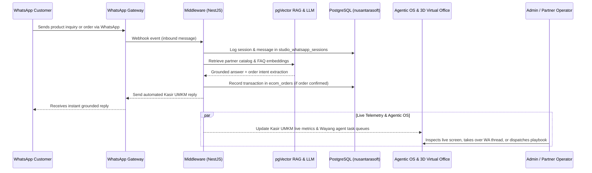

# NusantaraSoft — AI Studio, UMKM WhatsApp Kasir, Agentic OS & 3D Virtual Office

**Tactical AI Builder Platform for UMKM & Enterprise Operations (`v3.2.0`)**

NusantaraSoft is a full-stack AI platform combining a **NotebookLM-style RAG Studio**, **UMKM Partner & WhatsApp Kasir automation**, **Knowledge Research & Showcase generation**, a **Mission-Control Agentic OS**, and an **Interactive 3D Virtual Office** powered by autonomous Wayang AI agents.

---

## ✨ Key Capabilities

| Pillar | Highlights |
|---|---|
| **AI Studio (`/admin/ai-studio`)** | 3-column Notebook RAG workspace with multi-source ingestion (PDF, URL, YouTube, Audio, Text), 768-dim pgVector hybrid retrieval, grounded chat citations, flashcards, quiz, mind map, audio/video overview, and guided flows. |
| **UMKM Partner & WA Kasir (`/admin/ai-studio/partner`)** | Partner store onboarding, product catalog & stock management, automated WhatsApp cashier (`Kasir UMKM`), sales order tracking, and live WhatsApp simulator. |
| **Knowledge Research (`/admin/ai-studio/knowledge-research`)** | Super-admin RAG research & synthesis pipeline with web/source crawling, stage telemetry, and one-click indexing into Studio notebooks. |
| **Showcase & Marketing (`/admin/ai-studio/showcase`)** | Tactical Showcase Studio & Card Inspector Deck that generates UMKM promotional copy, visual cards, and publishes directly to the Digital Brochure Gallery. |
| **Messages Inbox (`/admin/ai-studio/messages`)** | Real-time WhatsApp customer conversation monitor with human operator takeover, AI auto-reply status, and quick-reply templates. |
| **Unified Settings & WA Gateway (`/admin/ai-studio/settings`)** | Multi-provider LLM matrix (Google Gemini, Vertex AI, OpenAI, Anthropic, DeepSeek, Groq, Ollama), vector embedding configuration, and Hermes WhatsApp Gateway QR pairing. |
| **Agentic OS (`/admin/agentic-os`)** | **MAPS** architecture (**M**emory Map, **A**gent Studio & Workflows, **P**ulse Scheduler & Caps, **S**creen Deck & Governance Approvals) backed by a persistent Postgres task runner. |
| **3D Virtual Office (`/admin/virtual-office`)** | Real-time Three.js / React Three Fiber 3D headquarters where 8 Wayang AI agents + the live `Kasir UMKM` employee walk between zones, execute playbooks on live module screens, and collaborate in the War Room. |
| **Brochure Gallery (`:3004`) & Landing Page (`:3000`)** | Public-facing showcase gallery for UMKM partner brochures and platform landing page. |

---

## 🏗️ System Architecture

### High-Level Architecture



---

### End-to-End Flow: UMKM WhatsApp Kasir, RAG Studio & Agentic OS



---

## 🧭 Active Surfaces & Routes

```text
Admin Application (:3003)
├── Auth Surfaces
│   ├── Tactical Sign-In                              /login (/sign-in, /admin/login)
│   └── Tactical Registration                         /register
├── AI Studio (/admin/ai-studio)
│   ├── Studio (Notebook RAG & Multi-Output Deck)     /admin/ai-studio
│   ├── Partner (UMKM Store Command & WA Kasir)       /admin/ai-studio/partner
│   ├── Knowledge Research (Super-Admin RAG Pipeline) /admin/ai-studio/knowledge-research
│   ├── Showcase (HUD Showcase Studio & Card Deck)    /admin/ai-studio/showcase
│   ├── Messages (Realtime WA Inbox & Takeover)       /admin/ai-studio/messages
│   └── Settings (LLM Models, Embeddings & WA Gateway)/admin/ai-studio/settings
├── Agentic OS (Mission-Control Multi-Agent OS)       /admin/agentic-os
└── Virtual Office (3D Wayang Agent HQ)               /admin/virtual-office

Public & Partner Applications
├── Landing Page                                      http://localhost:3000
└── Brochure Gallery                                  http://localhost:3004
```

> **Navigation Tip**: Every Admin page includes the interactive **Agentic OS Ring & 3D Orbit Navigator** in the bottom corner, allowing one-click switching between `RINGS` and `3D ORBIT` modes to jump across AI Studio modules, Agentic OS, and the 3D Virtual Office.

---

## 🤖 Agentic OS & 3D Virtual Office Roster

All agents, playbooks, task templates, memory map signposts, routines, workflows, and goals operate strictly on the **8 active system modules**:

| Agent | Role | Floor Zone | Assigned Modules | Active Routes |
|---|---|---|---|---|
| **Kasir UMKM** *(Live)* | UMKM WhatsApp Kasir | WhatsApp & Partner Ops | `wa-conversations`, `whatsapp-gateway`, `partner` | `/admin/ai-studio/messages`, `/admin/ai-studio/partner` |
| **Nakula** | AI Studio & Prompt Lead | AI Studio & Gateway | `ai-studio`, `settings` | `/admin/ai-studio`, `/admin/ai-studio/settings` |
| **Arjuna** | WhatsApp Gateway Engineer | AI Studio & Gateway | `whatsapp-gateway`, `settings` | `/admin/ai-studio/settings?tab=whatsapp` |
| **Gatotkaca** | Model & Safety Auditor | AI Studio & Gateway | `settings`, `agentic-os` | `/admin/ai-studio/settings`, `/admin/agentic-os` |
| **Yudhistira** | Knowledge Research Curator | Knowledge & Marketing | `knowledge`, `ai-studio` | `/admin/ai-studio/knowledge-research`, `/admin/ai-studio` |
| **Drupadi** | Marketing Content Strategist | Knowledge & Marketing | `marketing`, `knowledge` | `/admin/ai-studio/showcase`, `/admin/ai-studio/knowledge-research` |
| **Kresna** | Partner Growth Lead | Knowledge & Marketing | `partner`, `marketing` | `/admin/ai-studio/partner`, `/admin/ai-studio/showcase` |
| **Semar** | WA Conversation Specialist | WhatsApp & Partner Ops | `wa-conversations`, `knowledge` | `/admin/ai-studio/messages`, `/admin/ai-studio/knowledge-research` |
| **Petruk** | Agentic OS & Partner Ops | WhatsApp & Partner Ops | `agentic-os`, `partner`, `wa-conversations` | `/admin/agentic-os`, `/admin/ai-studio/partner` |

---

## 📁 Repository Structure

```text
juragan-aibuilder-cup/
├── admin/                 # Next.js 16 Admin CMS, AI Studio, Agentic OS & 3D Virtual Office (:3003)
│   └── src/
│       ├── app/
│       │   ├── login/ & register/      # Tactical HUD Auth surfaces
│       │   └── admin/
│       │       ├── ai-studio/          # Studio, Partner, Knowledge Research, Showcase, Messages, Settings
│       │       ├── agentic-os/         # Mission-Control Agentic OS Deck (MAPS)
│       │       └── virtual-office/     # 3D Wayang AI Agent HQ (Three.js / R3F)
│       ├── components/                 # Tactical HUD layout, FloatingOrbMenu, Agentic OS apps
│       └── lib/                        # GraphQL client, Studio & WhatsApp services
├── middleware/            # NestJS + GraphQL API Server (:4001)
│   └── src/
│       ├── studio/                     # AI Studio, RAG Notebooks, UMKM Partner, Showcase & Settings
│       ├── whatsapp/                   # Hermes WhatsApp Gateway bridge & operator takeover
│       ├── agentic-os/                 # Autonomous agent runner, Pulse scheduler, memory & goals
│       ├── ai/                         # Multi-provider LLM & embedding runtime
│       ├── auth/                       # Supabase GoTrue JWT & role resolution
│       └── media/                      # MinIO S3 & pgVector media pipeline
├── brochure-gallery/      # Next.js Digital Brochure & Showcase Gallery (:3004)
├── landing-page/          # Next.js Public Website (:3000)
├── supabase/              # Consolidated PostgreSQL + pgVector SQL files
│   ├── migrations/                     # Ordered schema & Agentic OS migrations
│   ├── modules/                        # Modular SQL schemas
│   └── qa-seeds/                       # QA & demo seed data
├── docs/                  # Architecture, AI Studio, UMKM WA & Cloud Run guides
├── diagrams/              # L1–L4 Mermaid architecture & sequence diagrams
├── scripts/               # Local dev, Docker stack & GCP Cloud Run deploy scripts
├── cloudbuild.yaml        # Google Cloud Build + Cloud Run deployment pipeline
└── docker-compose.yml     # Local & container stack orchestration
```

---

## 🚀 Quick Start

### 1. Environment Setup

Copy the example environment file and configure your local keys:

```bash
cp .env.example .env
```

> 🔐 **Security Note**: `.env` files are git-ignored. Never commit plaintext API keys or credentials to the repository. In production on Google Cloud Run, secrets are injected via **Google Cloud Secret Manager**.

### 2. Run with Docker Compose

```bash
# Start core backend & application services
docker compose up -d postgres kong auth rest realtime storage minio middleware admin landing-page brochure-gallery

# Rebuild and restart Admin & Middleware after code changes
docker compose build middleware admin
docker compose up -d --no-deps middleware admin
```

### 3. Local Service Endpoints

| Service | Local URL | Purpose |
|---|---|---|
| **Admin CMS & AI Studio** | `http://localhost:3003/admin/ai-studio` | Main AI Studio, Partner, Messages, Settings |
| **Agentic OS** | `http://localhost:3003/admin/agentic-os` | Multi-agent OS (Memory, Studio, Pulse, Deck) |
| **3D Virtual Office** | `http://localhost:3003/admin/virtual-office` | Interactive 3D Wayang Agent Headquarters |
| **Middleware GraphQL** | `http://localhost:4001/graphql` | NestJS GraphQL API & Health (`/health`) |
| **Landing Page** | `http://localhost:3000` | Public landing website |
| **Brochure Gallery** | `http://localhost:3004` | Public UMKM digital brochure showcase |
| **Supabase API Gateway** | `http://localhost:8000` | Kong gateway for Auth, PostgREST, Realtime |
| **MinIO Console** | `http://localhost:9001` | S3-compatible object storage console |

---

## ☁️ Deploying to Google Cloud Run

This repository is pre-configured for **Google Cloud Run** + **Cloud Build** + **Secret Manager**:

- **Pipeline definition**: [`cloudbuild.yaml`](cloudbuild.yaml)
- **Automated deploy scripts**:
  - PowerShell (Windows): [`scripts/deploy-cloudrun.ps1`](scripts/deploy-cloudrun.ps1)
  - Bash (Linux / macOS / Cloud Shell): [`scripts/deploy-cloudrun.sh`](scripts/deploy-cloudrun.sh)
- **Step-by-step guide**: [`docs/deploy-cloud-run.md`](docs/deploy-cloud-run.md)

```powershell
# Example: Deploy via PowerShell
.\scripts\deploy-cloudrun.ps1 -ProjectId "your-gcp-project-id" -Region "asia-southeast2"
```

---

## 📚 Documentation & Diagrams

- **AI Studio & UMKM WhatsApp Overview**: [`docs/aistudio/README.md`](docs/aistudio/README.md)
- **Agentic OS & Active Agent Roster**: [`docs/aistudio/studio/business/agentic-os-first-employee.md`](docs/aistudio/studio/business/agentic-os-first-employee.md)
- **RAG Architecture (L1–L4)**: [`docs/aistudio/studio/system/rag-architecture.md`](docs/aistudio/studio/system/rag-architecture.md)
- **Brochure Gallery Guide**: [`docs/brochure-gallery/README.md`](docs/brochure-gallery/README.md)
- **Google Cloud Run Deployment Guide**: [`docs/deploy-cloud-run.md`](docs/deploy-cloud-run.md)
- **System & Sequence Diagrams**: [`diagrams/aistudio/`](diagrams/aistudio/)

---

## 📝 License

MIT
