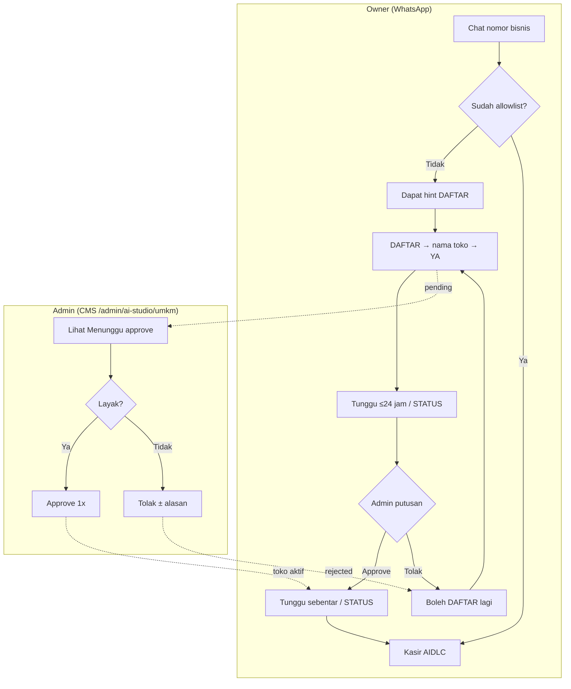
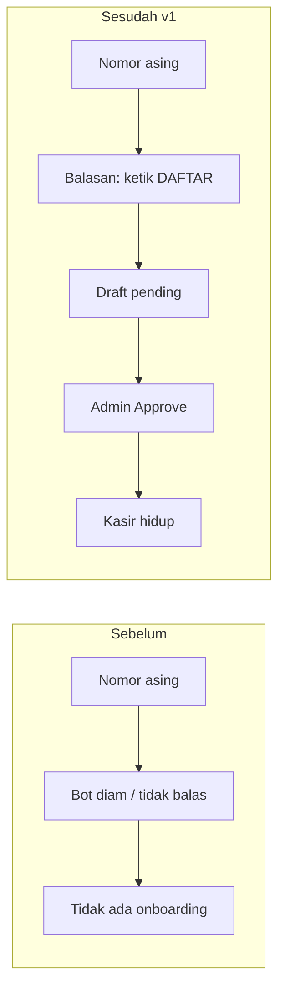
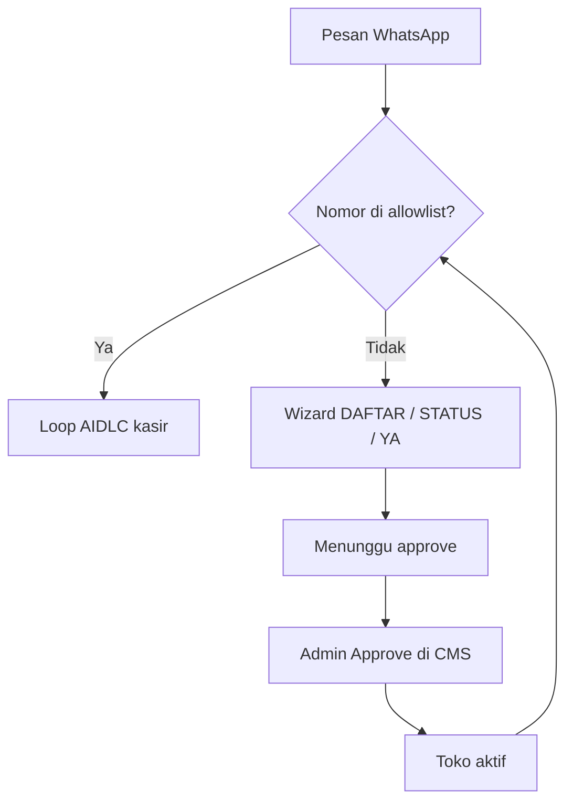
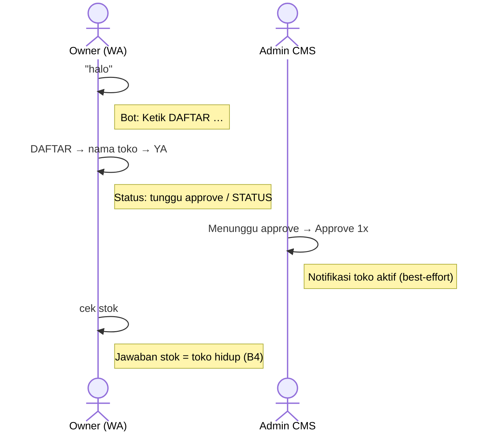
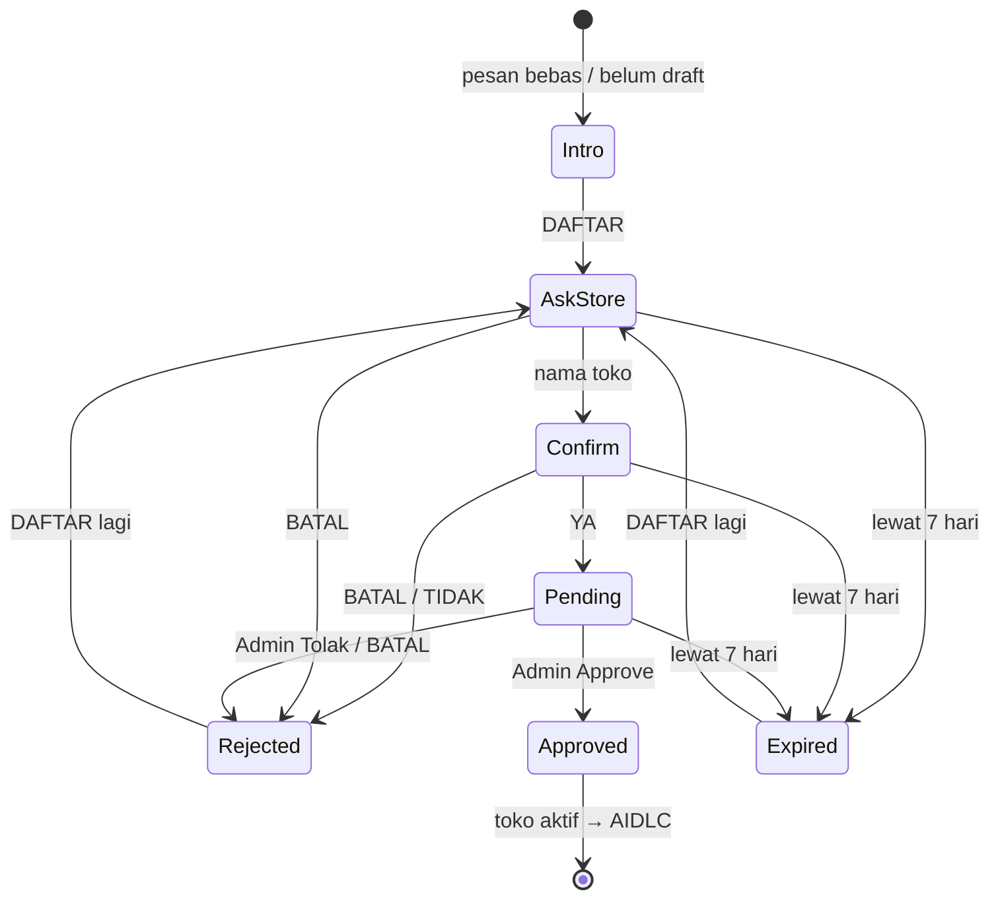
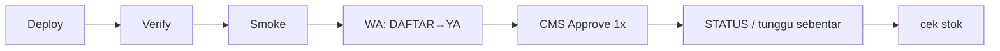

# AI Studio — UMKM WA: konsep bisnis, AIDLC, dan jalur trial

Date: 2026-09-19  
Status: **CEO SCOPE REDUCTION locked** (trial v1)  
Parent (produk): [register-admin-approve.md](./register-admin-approve.md)  
Sistem (Hermes / deploy): [../../system/hermes-architecture.md](../../system/hermes-architecture.md)  
Pitch sales/tenant: [../pitch.md](../pitch.md)

Dokumen **ops internal**: trial, AIDLC, checklist. Sales mulai dari [pitch.md](../pitch.md). Detail runtime: [system/](../../system/).

---

## 1. Konsep bisnis (satu kalimat)

Pemilik warung chat ke nomor bisnis → ketik **DAFTAR** → admin setujui di AI Studio → nomor masuk allowlist → baru boleh pakai **kasir WhatsApp** (catat jual, cek stok, laporan, tutup toko, **tanya kurikulum** — **chat teks**).

Tanpa langkah itu, nomor asing dulu diabaikan (bot “mati”). Funnel ini mengganti silent-drop dengan onboarding yang jelas, tanpa OTP/bayar di v1.

Konsultasi kurikulum (soft GA): lihat [consult-kurikulum.md](./consult-kurikulum.md).

### 1.1 Aturan proses bisnis v1 (locked)

| # | Aturan | Keputusan |
|---|--------|-----------|
| B1 | Aktor | **Owner (WhatsApp)** + **Admin (CMS)** saja |
| B2 | Siapa boleh DAFTAR | **Open funnel** — nomor mana pun boleh mulai; Admin menyaring via Approve/Tolak |
| B3 | SLA pending | Ekspektasi bisnis **hari yang sama / ≤24 jam**; draft kedaluwarsa setelah 7 hari |
| B4 | “Toko hidup” | **Approve + `cek stok` berhasil**. Transaksi jual = fase berikutnya |
| B5 | Setelah Tolak / BATAL | Owner **boleh DAFTAR lagi langsung** |
| B6 | Identitas | **1 toko = 1 nomor owner** di v1 (karyawan / multi-HP = out of scope) |
| B7 | Nomor WA | **1 nomor bisnis NusantaraSoft shared** (bukan 1 nomor per toko) |

**Diagram bisnis (SVG):** pitch sales → L0–L2 (+ L0b, **L0c**) di [pitch.md](../pitch.md). Full ladder termasuk L3–L4: [`diagrams/.../business/`](../../../../../diagrams/aistudio/umkm-wa/business/). System gate: [`L7-inbound-gate.svg`](../../../../../diagrams/aistudio/umkm-wa/system/L7-inbound-gate.svg) · knowledge/SOUL: [`L8-knowledge-soul.svg`](../../../../../diagrams/aistudio/umkm-wa/system/L8-knowledge-soul.svg).



**Definisi sukses bisnis (B4):** setelah Approve, owner mendapat jawaban bermakna untuk `cek stok` (stok kosong tetap valid). Itu bukti kasir hidup; isi katalog & jual pertama = pekerjaan berikutnya.



**Nilai uji coba sukses (= B4):** satu nomor nyata bisa `cek stok` setelah Approve — belum wajib ada transaksi jual.

---

## 2. Di mana ini di peta AI Studio

```
AI Studio (Admin CMS)
├── Studio notebook RAG          ← knowledge / NotebookLM
├── Settings / Gateway           ← provider, pair WA
└── UMKM  /admin/ai-studio/umkm  ← tenant kasir WA  ★ dokumen ini
        ├── Form "Tambah UMKM"     (admin provision — jalur lama)
        └── Antrian "Menunggu approve"  (self-serve DAFTAR — jalur baru)
```

Self-serve **bukan** mengganti form admin; keduanya menghasilkan toko aktif di CMS. Trial menguji jalur **DAFTAR**.

---

## 3. AIDLC — apa artinya di sini (produk)

**AIDLC** di modul UMKM = siklus percakapan kasir setelah toko aktif:

```
pahami pesan → routing intent → preview konfirmasi → commit → evaluasi
```

Contoh setelah toko aktif:

| Pesan owner | Hasil |
|-------------|--------|
| `jual 2 indomie` | Preview jual → `ya` → tercatat |
| `satu lagi` | Ulang item jual terakhir → `ya` |
| `cek stok` | Balasan sisa stok |
| `laporan` / omzet | Ringkasan penjualan |
| `tutup toko` | Omzet hari ini + stok menipis |
| foto / voice (default) | Arahkan ketik jual/stok (chat-only) |

Funnel **DAFTAR** berada **sebelum** AIDLC:



Wizard daftar sengaja sederhana (bukan chat AI penuh): hemat biaya, langkah jelas, hindari penyalahgunaan sebelum toko resmi.

---

## 4. Alur end-to-end (owner + admin)



Detail teknis gate, plugin, dan GraphQL: [../../system/hermes-architecture.md](../../system/hermes-architecture.md).

---

## 5. State machine pendaftaran (wizard)



Satu nomor hanya boleh punya satu pendaftaran terbuka (draft/pending) pada satu waktu.

Diagram L4: [`L4-wizard-state.svg`](../../../../../diagrams/aistudio/umkm-wa/business/L4-wizard-state.svg)

---

## 6. Gate allowlist (bahasa bisnis)

Setiap pesan: **sudah di allowlist?** → kasir · **belum?** → wizard DAFTAR (atau diam jika fitur daftar dimatikan ops).

Setelah Approve, tunggu sebentar atau ketik **STATUS** sebelum `cek stok` agar status toko sudah terbaca.

Diagram L3: [`L3-gate-teknis.svg`](../../../../../diagrams/aistudio/umkm-wa/business/L3-gate-teknis.svg)  
Implementasi: [system/](../../system/)

---

## 7. Keputusan produk (SCOPE REDUCTION) — locked

| Keputusan | Ringkas |
|-----------|---------|
| Mode | Seminimal ke **satu tenant hidup** |
| Approach | Funnel **DAFTAR** di chat (bukan hanya form admin) |
| Approve | Satu klik di CMS; SLA bisnis ≤24 jam |
| Bukti sukses | Manual E2E: `cek stok` setelah Approve (**B4**) |
| Out of scope v1 | OTP, bayar, multi-HP/toko, admin WA ping pending, wizard AI penuh |

Rollback bisnis: ops dapat mematikan funnel daftar → nomor asing lagi diam; toko yang sudah di-approve tetap kasir. Cara teknis: [hermes-local.md](../../system/hermes-local.md).

---

## 8. Jalur trial (checklist operasional)



1. Deploy + verify + smoke (lihat skrip di [system](../../system/hermes-local.md)).
2. WA nyata (nomor belum allowlist): `halo` → `DAFTAR` → nama toko → `YA`.
3. CMS `/admin/ai-studio/umkm` → **Menunggu approve** → Approve sekali.
4. Ketik `STATUS` (harus “Toko aktif…”) lalu `cek stok`.
5. Sukses = **B4**.

### Kriteria lulus

| # | Kriteria |
|---|----------|
| 1 | Nomor asing dapat balasan menyebut DAFTAR (bukan diam) |
| 2 | YA → muncul di CMS Menunggu approve |
| 3 | Approve → toko aktif; registration approved |
| 4 | `cek stok` dijawab kasir (bukan intro DAFTAR) — **B4** |
| 5 | Pending dijanjikan **≤24 jam** (B3); 1 phone = 1 toko (B6) |

---

## 9. Riwayat

| Tanggal | Catatan |
|---------|---------|
| 2026-09-12 | Design parent IMPLEMENTED (code) |
| 2026-09-19 | SCOPE REDUCTION; aturan B1–B7 dikunci |
| 2026-09-19 | Dipindah ke `docs/aistudio/umkm-wa/business/` (pisah business vs system) |
