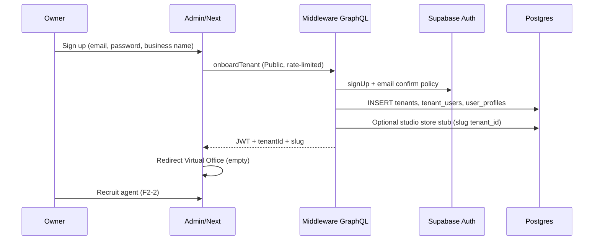

# F2-1 — Self-serve tenant registration & onboarding (design draft)

**Status:** Decisions locked (Akbar approved) · **Backlog:** F2-1 · **Owner:** PO-NS3  
**Updated:** 2026-10-15  
**Scope:** Approved design — implementation PR targets `master` (not `master-production`).

## Target outcome (Fase 2)

A new business owner can **self-register**, **create their business/store**, and land in an **empty Virtual Office** with a clear path to **recruit agents** from Agentic OS — without manual CMS setup for every tenant.

Related Phase 1 context (merged #34–#39): Virtual Office **Live** mode and **empty floor** UX already exist when a tenant has no DB-backed AOS agents (`EmptyOfficeBanner`, F1-2).

---

## 1. How it works today

### 1.1 Auth signup (GraphQL / Supabase)

| Step | Behavior | Evidence |
|------|----------|----------|
| Public mutation | `signUp` and `signIn` are explicitly public (bypass `GlobalAuthGuard`). | `middleware/src/auth/auth.resolver.ts:69-97`, `middleware/src/auth/public-endpoints.registry.ts:6-7` |
| Supabase | Sign-up calls `auth.signUp` with optional `user_metadata` (`name`). | `middleware/src/auth/auth.service.ts:66-82` |
| Profile / role | Sign-in resolves `user_profiles.role` and `status`; sign-up does **not** create `user_profiles` or `tenant_users`. | `middleware/src/auth/auth.service.ts:21-34`, `66-82` |
| Tokens on sign-up | Resolver returns **user only** (no `accessToken` / `refreshToken` in response). | `middleware/src/auth/auth.resolver.ts:86-96` |
| Admin UI | Login page is **sign-in only**; no register route in admin app. | `admin/src/app/login/page.tsx:33-47` |
| Client hook | `AuthContext.signUp` exists and expects tokens (may not match server response). | `admin/src/context/AuthContext.tsx:189-207` |
| Bootstrap admin | Production/dev super-admin is created by **script** (Auth admin API + `user_profiles` SQL), not self-serve. | `scripts/init-cms-admin.mjs:49-78` |

**Manual today:** Operator runs `init-cms-admin.mjs` (or equivalent) for platform admins.  
**Automated today:** Any client can call public `signUp` GraphQL mutation (creates Supabase Auth user only).

### 1.2 `tenants`, `tenant_users`, and platform tenant binding

| Layer | Behavior | Evidence |
|-------|----------|----------|
| Schema | `tenants` (UUID), `tenant_users` links `user_id` → `tenant_id` with profile/role. | `supabase/migrations/00000000000060_consolidated_init.sql:26-37`, `112-136` |
| Seed tenant | Single default org `00000000-0000-0000-0000-000000000010` / slug `default`. | `supabase/migrations/00000000000060_consolidated_init.sql:393-395` |
| Create tenant API | `createTenant` mutation inserts row; default plan `free`. | `middleware/src/tenants/tenants.service.ts:30-39`, `middleware/src/tenants/tenants.resolver.ts:76-79` |
| Create membership | `createTenantUser` inserts into `tenant_users` (no auth-user bootstrap). | `middleware/src/permissions/permissions.service.ts:266-278` |
| Admin usage | Most CRM/modules pass **hardcoded** `DEFAULT_TENANT_ID` (`…0010`), not JWT-derived tenant. | `admin/src/lib/graphql.ts:14-15` |
| AOS default | Agentic OS uses same UUID default tenant constant. | `middleware/src/agentic-os/agentic-os.types.ts:4` |
| Tenants admin UI | `/admin/tenants/*` pages use **static demo** tenant list, not GraphQL `tenants`. | `admin/src/app/admin/tenants/configuration/page.tsx:14-24` |

**Manual today:** Creating orgs and linking users via permissions/tenant APIs or DB; operators work inside the default tenant in UI.  
**Automated today:** None for “signup → new tenant → membership”.

### 1.3 Store / WhatsApp linking (UMKM path)

Two parallel notions of “tenant” exist:

1. **`public.tenants`** — UUID, RBAC/CRM foundation.  
2. **Studio / UMKM `tenant_id` (string slug)** — e.g. `umkm-warung-bu-ani`, used in `studio_whatsapp_config`, AOS, kasir.

#### WA self-serve (owner phone, not web account)

| Step | Behavior | Evidence |
|------|----------|----------|
| Gate | Non-allowlisted senders → registration funnel if `KASIR_REGISTRATION=1`. | `scripts/master-production/hermes-plugins/kasir-pipe/__init__.py:326-337`, `356-362` |
| Wizard | Pure state machine: `DAFTAR` → store name → `YA` → pending. | `scripts/master-production/hermes-plugins/kasir-pipe/register.py:28-30`, `51-75` |
| Persistence | Hermes writes `studio_umkm_registrations` via Supabase REST. | `scripts/master-production/hermes-plugins/kasir-pipe/__init__.py:455-468`, `512+`; table `supabase/migrations/00000000000104_studio_umkm_registrations.sql:1-19` |
| Admin queue | CMS lists pending rows; approve/reject mutations. | `middleware/src/studio/studio.resolver.ts:753-787`, `admin/src/app/admin/ai-studio/umkm/page.tsx:617+` |
| Approve provisioning | Creates notebook, `setupUmkmNotebook`, upserts `studio_whatsapp_config` (allowlist owner phone). **Does not** insert `public.tenants` or `tenant_users`. | `middleware/src/studio/studio-umkm-registration.service.ts:101-148`, `129-148` |
| WA config | `updateConfig` upserts by string `tenant_id`; owner phone required when enabling. | `middleware/src/studio/studio-whatsapp.service.ts:242-302` |
| Ops doc | WA DAFTAR + admin approve is **implemented** for kasir wedge. | `docs/aistudio/umkm-wa/business/ops/register-admin-approve.md:14-18` |

#### Manual WA / store setup (non-DAFTAR)

| Action | Manual? | Evidence |
|--------|---------|----------|
| Pair business WhatsApp (QR) | **Manual** — Admin WhatsApp Gateway / Hermes `:8765` | `middleware/STUDIO_WHATSAPP.md:31-38` |
| Add UMKM + allowlist via form | **Manual** — Admin AI Studio UMKM | `middleware/STUDIO_WHATSAPP.md:37-38` |
| Approve DAFTAR queue | **Manual** — Admin click Approve | `middleware/src/studio/studio-umkm-registration.service.ts:101-177` |

**Automated today (WA path):** DAFTAR wizard, draft/pending rows, expiry (7 days), approve-side notebook + WA config + owner notify (best-effort).

### 1.4 Security posture relevant to onboarding

| Control | State | Evidence |
|---------|--------|----------|
| Default deny GraphQL | `GlobalAuthGuard` on all operations except `@Public()` / `@AlternativeAuth()`. | `middleware/src/auth/global-auth.guard.ts:45-77`, `middleware/src/auth/auth.module.ts:14-16` |
| Public auth surface | `signUp`, `signIn`, `me`, `refreshToken` public. | `middleware/src/auth/auth.resolver.ts:69-133` |
| Tenant arg trust | Many resolvers still accept client `tenantId` (High follow-up from access audit). | `docs/security/access-control-audit-2026-10-14.md:26-27`, `65-66` |
| WA rate limit | In-memory limiter on inbound/sim path (per phone/tenant). | `middleware/src/studio/studio-whatsapp.util.ts:148+`, `studio-whatsapp.service.ts:516` |
| Sign-up rate limit | **Not implemented** in app (nginx `limit_req` noted for GraphQL). | `docs/security/access-control-audit-2026-10-14.md:50-51`, `67-68` |

### 1.5 Virtual Office empty state (Phase 1 — ready for F2-1 landing)

| Behavior | Evidence |
|----------|----------|
| Empty floor when no DB-backed agents | `isEmptyLiveOffice` | `admin/src/app/admin/virtual-office/lib/officeRuntimeMode.ts:22-25` |
| UX copy + CTA to Agent Studio | `EmptyOfficeBanner` | `admin/src/app/admin/virtual-office/hud/EmptyOfficeBanner.tsx:17-28` |
| Live vs demo | F1-2: real queue unless explicit UI demo mode | `docs/audit/dummy-vs-real-2026-10-15.md:11` |

---

## 2. Gaps vs target flow

Target: **Web (or unified) self-signup → business/store record → JWT bound to new tenant → empty VO → recruit agents.**

| Gap | Today | Target |
|-----|--------|--------|
| **Identity → tenant** | Auth user unrelated to `tenant_users` | One owner membership per new org |
| **Org creation** | `createTenant` exists but not wired to signup | Atomic signup + tenant + owner row |
| **Dual tenant IDs** | UMKM uses string slug; platform uses UUID | Single canonical tenant key (or documented bridge) |
| **WA onboarding** | Phone-only; no CMS login for owner | Optional: link phone registration to web account |
| **Admin gate** | WA path requires **admin approve** | F2 may allow instant trial or keep approve — **Akbar** |
| **Admin UI tenant** | Hardcoded `DEFAULT_TENANT_ID` | Session resolves active tenant from membership |
| **VO landing** | Works when tenant has zero AOS agents; user must already reach VO with correct tenant context | Post-onboarding redirect to `/admin/virtual-office` for **their** tenant |
| **Recruit agents** | F2-2/F2-3 not built | Empty VO CTA exists; catalog/recruit/channel connect still TODO (`docs/backlog.md:19-22`) |
| **Self-serve web signup UI** | No public registration page | Landing/admin signup or invite flow |
| **Abuse controls** | Open public `signUp` | Rate limits, captcha, email verify — **Akbar** |

---

## 3. Proposed minimal flow (implementation sketch — not in this PR)

Design goal: **smallest vertical slice** that satisfies F2-1 without rewriting Hermes or all CRM pages.

### 3.1 Happy path (web-first MVP)

**Steps (logical):**

1. **Single public mutation** (preferred over raw `signUp`): validates input, creates Auth user, `tenants` row, default profiles/roles for that tenant, `tenant_users` owner link, `user_profiles` with `tenant_owner` (or equivalent) role.
2. **Session** returns tokens only when Supabase policy allows (handle confirm-email path explicitly in UI).
3. **Redirect** to Virtual Office; `EmptyOfficeBanner` already explains next step (F1-2).
4. **Optional:** create minimal `studio_whatsapp_config` disabled stub if business name captured (WA connect remains F2-3).

### 3.2 Bridge existing WA DAFTAR (later slice)

- On approve (or auto-approve trial), also insert/link `public.tenants` + map string `tenant_id` ↔ UUID in `tenants.settings` or a `tenant_external_ids` table.
- Allow owner to **claim** pending WA registration by OTP/email match — **product decision**.

### 3.3 Data model additions (minimal)

| Artifact | Purpose |
|----------|---------|
| `tenants.settings.onboarding` | `{ source: 'web' \| 'wa_daftar', storeDisplayName, waPhone? }` |
| `tenant_users.user_id` NOT NULL for owners | Enforce auth binding |
| Optional `tenant_slug_aliases` | Map `umkm-*` string → UUID during migration |
| `user_profiles.primary_tenant_id` | Fast default tenant for JWT (alternative: junction only) |

Reuse existing tables where possible; avoid duplicating `studio_umkm_registrations` for web signups unless WA and web funnels merge.

### 3.4 Security & isolation

| Requirement | Approach |
|-------------|----------|
| **Per-tenant isolation** | Resolve `tenantId` from JWT + `tenant_users` membership; reject mismatched GraphQL args (extend access-control audit #18 follow-up). |
| **GlobalAuthGuard** | New onboarding mutation `@Public()` + **Throttler** / IP cap; all post-login routes guarded as today. |
| **Roles** | New signups get tenant-scoped owner profile, not `super_admin`. |
| **Anti-abuse** | Rate limit `onboardTenant` + `signUp`; optional captcha; disposable-email blocklist; max tenants per IP/day. |
| **WA funnel** | Keep Hermes registration on service role; no anon write to `studio_umkm_registrations` from browser. |
| **Audit** | Log tenant creation + approver id for WA path. |

Patterns align with `docs/security/access-control-audit-2026-10-14.md` and `docs/design-permissions.md` (multi-tenant foundation).

### 3.5 Out of scope for minimal F2-1

- Full CRM tenant switcher refactor (can follow incrementally).
- Self-serve Hermes QR pairing (F2-3).
- Agent catalog (F2-2).
- Billing (F3-4).

---

## 4. Decisions (approved)

Locked by Akbar for F2-1 MVP implementation:

| # | Decision | Approved choice |
|---|----------|-----------------|
| D1 | **Primary signup channel for F2-1 MVP** | **Web `/register`** for email/password signup; owner **links WhatsApp after signup**. WA **DAFTAR** remains a parallel entry that feeds the **same provisioning pipeline**. |
| D2 | **Admin approval for new tenants** | **Instant trial — no admin approval.** Abuse handled via **rate limits + captcha** on web signup. |
| D3 | **Email verification** | **Required** before Virtual Office / authenticated product access. |
| D4 | **Default subscription plan** | **`trial` for 14 days**, then automatically **`free`**. |
| D5 | **Canonical tenant identifier** | **`public.tenants.id` = UUID** (canonical). Legacy UMKM **string slugs** mapped via **`tenant_slug_aliases`** (and settings) — not removed in v1. |
| D6 | **Default modules for new tenant** | **Agentic OS (AOS) + Virtual Office (VO) only**; **empty VO floor** on first login. |
| D7 | **Owner role naming** | Signup user is **`tenant_owner`** (`user_profiles` + `tenant_users` owner membership). |
| D8 | **Public signup entrypoint** | Admin app route **`/register`** (not invite-only). |
| D9 | **Relationship to existing DAFTAR queue** | **Keep WA DAFTAR**; on wizard completion route into **same provisioning pipeline** as web (no separate manual approve step). |
| D10 | **Abuse / spam policy** | **Rate limits + captcha** on web signup; WA path keeps Hermes/service-role writes (no browser anon). |
| D11 | **Multi-store per owner** | **One store per owner (v1).** |
| D12 | **Prod tenant `umkm-warung-klontong-bahagia`** | **Migrate via slug→UUID mapping**; **must not lose data** (configs, notebooks, AOS rows). |
| D13 | **Per-store WhatsApp whitelist** | Each store maintains a **whitelist of WA numbers** (owner + staff the owner adds). **Only whitelisted numbers** may use that store's agents (kasir/AOS WA paths). |

### Provisioning pipeline (single path)

Web signup and WA DAFTAR both call the same server-side provisioner:

1. Create **`public.tenants`** row (UUID) + **`tenant_slug_aliases`** for studio string `tenant_id`.
2. Create **`tenant_users`** owner link + **`user_profiles`** (`tenant_owner`) for web signups.
3. Set **`subscription_plan = trial`**, **`trial_ends_at = now + 14 days`**, default modules **`aos` + `vo`** in `tenants.settings`.
4. Create **one store** stub + disabled/minimal **`studio_whatsapp_config`**; owner adds/links WA post-signup.
5. Seed **WA whitelist** with owner phone (WA path) or empty until linked (web path).
6. Redirect / notify → **empty Virtual Office** (Phase 1 empty floor UX).

---

## 5. References

| Doc | Relevance |
|-----|-----------|
| [docs/backlog.md](../backlog.md) | F2-1…F2-4 |
| [docs/aistudio/umkm-wa/business/ops/register-admin-approve.md](../aistudio/umkm-wa/business/ops/register-admin-approve.md) | Current WA onboarding |
| [docs/security/access-control-audit-2026-10-14.md](../security/access-control-audit-2026-10-14.md) | GlobalAuthGuard, tenant binding debt |
| [docs/design-permissions.md](../design-permissions.md) | RBAC + tenant foundation |
| [docs/audit/dummy-vs-real-2026-10-15.md](../audit/dummy-vs-real-2026-10-15.md) | VO Live / empty state (Phase 1) |
| [middleware/STUDIO_WHATSAPP.md](../../middleware/STUDIO_WHATSAPP.md) | Hermes / WA ops |

---

## 6. Suggested implementation order (for future PRs)

1. `onboardTenant` mutation + throttling + tests (middleware).  
2. JWT tenant resolution helper + apply to AOS/VO queries (narrow scope).  
3. Admin signup page + post-login redirect to Virtual Office.  
4. Bridge WA approve → `public.tenants` (if D1/D5 choose dual-channel).  
5. Docs + ladder diagrams update per `.cursor/rules/docs-flow-diagrams-sync.mdc`.

---

*Implementation PR(s) on `master` follow this locked design. Do not deploy from `master-production` until ops promotes.*
