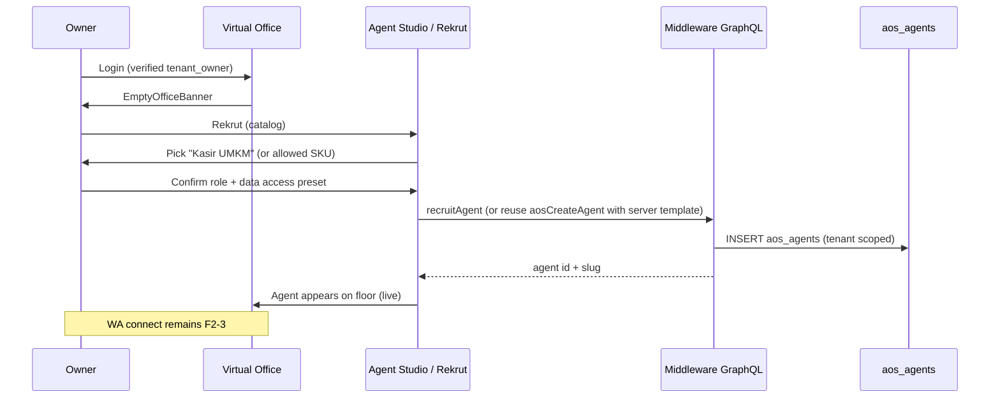

# F2-2 — Agent catalog & “rekrut” flow (design draft)

**Status:** **Decisions locked (Akbar approved 2026-10-15)** · **Backlog:** F2-2 · **Owner:** PO-NS3  
**Updated:** 2026-10-15  
**Scope:** Design locked for implementation. Builds on F2-1 (merged [#42](https://github.com/nusantarasoft/nusantarasoft-3/pull/42)): owner lands in **empty Virtual Office** and needs a productized path to **recruit** AI agents (role, data access) into **`aos_agents`**.

Related: F2-3 (WA channel connect), F3-1 (second agent SKU), [docs/design/f2-1-tenant-onboarding.md](f2-1-tenant-onboarding.md).

---

## 1. Target outcome (Fase 2)

After email-verified login, a **`tenant_owner`** can:

1. See a **catalog** of recruitable agent types (not the full Nusantarasoft internal roster).
2. **Rekrut** one agent with a guided flow: pick template → confirm role & modules → set data/tool permissions → agent appears on the **Virtual Office floor** and in **Agentic OS** with live task queue status.
3. For UMKM wedge v1, the **first recruit** should plausibly be **Kasir WA** (or an explicitly chosen alternative per Akbar).

Out of scope for minimal F2-2: Hermes QR pairing (F2-3), billing caps (F3-4), replacing AI Studio notebook setup for kasir.

---

## 2. How it works today

### 2.1 Empty Virtual Office → Agent Studio

| Step | Behavior | Evidence |
|------|----------|----------|
| Empty floor UX | When tenant has no DB-backed AOS agents, VO shows `EmptyOfficeBanner`. | `admin/src/app/admin/virtual-office/VirtualOffice.tsx`, `hud/EmptyOfficeBanner.tsx` |
| CTA | Banner button `launchOs("studio")` → **Agent Studio** in Agentic OS deck. | `EmptyOfficeBanner.tsx:21-28` |
| Copy | “Recruit agents from Agentic OS…” | `EmptyOfficeBanner.tsx:17-19` |

New F2-1 tenants are provisioned with modules **`aos` + `vo` only** and **no** seeded `aos_agents` rows (unlike default tenant `…0010`).

### 2.2 Agent catalog (static, client-side)

| Item | Behavior | Evidence |
|------|----------|----------|
| Templates | `AGENT_TEMPLATES` — Service Desk, DevOps, Finance, Security, Facilities, Sales, Blank. | `admin/src/components/agentic-os/lib/catalog.ts` |
| Tools & permissions | `TOOL_CATALOG`, `PERMISSION_LEVELS` drive Agent Editor. | same file |
| UMKM Kasir | **Not** a selectable template; shown as **read-only live card** “First recruited employee” via `fetchKasirLiveSnapshot` / GraphQL `aosKasirLiveSnapshot`. | `AgentStudio.tsx:174-189`, `firstEmployee.ts` |
| Kasir DB row | Seed `aos_agents` slug `umkm-kasir` exists only on **default tenant** UUID in migration. | `supabase/migrations/20261015120000_aos_umkm_kasir_agent_f1_3.sql` |

### 2.3 “Recruit” = manual create in Agent Studio

| Step | Behavior | Evidence |
|------|----------|----------|
| New agent | User picks template → `AgentEditor` draft → save calls `aosApi.createAgent`. | `AgentStudio.tsx:114-123`, `AgentEditor.tsx` |
| Persist | GraphQL `aosCreateAgent` → `agentic-os.service.createAgent` inserts **`aos_agents`** + version row. | `agentic-os.resolver.ts`, `agentic-os.service.ts:808-827` |
| Tenant scope | Uses JWT-resolved tenant (`resolveAosTenant` / `tenantOf`). | AOS resolvers |
| VO mapping | Live agents loaded via `osAgentSource` from real `aos_agents` for tenant. | F1-2 |

There is **no** dedicated “Rekrut” wizard, **no** server-side catalog, **no** one-click “Hire Kasir” for new tenants, and **no** enforcement of “first employee must be X”.

### 2.4 Kasir live metrics vs recruited agent

| Concern | Today |
|---------|--------|
| Kasir metrics | `AosKasirLiveService` reads `studio_whatsapp_*`, `ecom_orders` keyed by **studio string** `tenant_id` (resolved from UUID via store/slug). | `aos-kasir-live.service.ts` |
| Kasir on VO floor | Requires a row in **`aos_agents`** for that tenant (or demo mode). Live kasir card in Studio does **not** create that row. |
| Runner | Kasir seed uses `runner: browser`; generic templates default to `runner: cloud` in UI draft. | migration + `draftFromTemplate` |

### 2.5 Parallel “catalogs” (confusion risk)

| Surface | What it is |
|---------|------------|
| Agentic OS `AGENT_TEMPLATES` | Product path for F2-2 |
| HR `/admin/hr/recruitment` | Demo HR job postings (unrelated to AOS agents) |
| AI Studio UMKM admin | WA registration / notebooks (F2-1 / WA path) |

---

## 3. Gaps vs target

| Gap | Impact |
|-----|--------|
| Catalog is **enterprise-generic**, not **UMKM-first** | Owner sees DevOps/Security before Kasir |
| Kasir is **read-only metrics**, not **recruitable SKU** | Empty VO after signup; kasir card does not add agent to floor |
| Recruit flow is **expert Agent Editor** | Too many knobs (tools, guardrails, provider) for “rekrut karyawan” metaphor |
| No **limits** (trial max agents, allowed templates) | Abuse / cost risk |
| **F2-3 dependency** unclear in UX | Recruiting kasir without WA connected may feel broken |
| **Permissions** per module are manual | No preset “UMKM owner safe defaults” |
| No **audit** event “recruited agent X” beyond existing AOS user audit on create | May be enough for v1 |

---

## 4. Proposed minimal flow (implementation sketch — not in this PR)

Design goal: **smallest vertical slice** that connects empty VO → one recruited agent on the floor, without rewriting Agentic OS.

### 4.1 Happy path (UMKM-first v1 — per §5)

**Logical steps:**

1. **Entry:** Replace or augment “Open Agent Studio” with **“Rekrut agen”** (wizard or simplified catalog page).
2. **Catalog v1:** Server or config-driven list of **allowed templates per plan** (trial → Kasir only? — decision).
3. **Recruit mutation:** Wrap `createAgent` with template id + permission preset; validate tenant_owner + trial limits.
4. **Kasir template:** Insert agent slug `umkm-kasir` (or tenant-unique variant) with `runner`, modules, tools matching F1-3 expectations.
5. **Post-recruit:** Redirect to VO or show “Hubungkan WA” stub (F2-3).
6. **Optional:** Hide generic enterprise templates for `tenant_owner` until F3-1.

### 4.2 Data model (minimal)

| Artifact | Purpose |
|----------|---------|
| `agent_catalog_templates` (optional table) or JSON config | Akbar-controlled SKUs, plan gates |
| Reuse **`aos_agents`** | No second agent registry |
| `tenants.settings.recruit` | `{ maxAgents, allowedTemplateIds, recruitedAt }` |

Prefer **config/code catalog** for v1 if Akbar wants only 1–2 SKUs.

### 4.3 Security

| Requirement | Approach |
|-------------|----------|
| Tenant isolation | Same as AOS today: JWT tenant + membership |
| Who can recruit | **`tenant_owner`** (and platform admin); not anonymous |
| Tool/send permissions | Default **deny send** (`guardrails.denySend`) for UMKM presets |
| Rate limits | Optional cap on `createAgent` / `recruitAgent` per tenant/day |

---

## 5. Decisions (approved)

| # | Decision | **Approved choice** |
|---|----------|---------------------|
| D1 | **Catalog scope for trial tenants** | **Kasir UMKM only** as recruitable SKU; other agent types appear as **“segera hadir”** (coming soon) cards — not selectable. |
| D2 | **First recruit default (empty VO)** | **Push recruit Kasir first** — empty Virtual Office CTA routes to `/admin/recruit` with Kasir highlighted, not generic Agent Studio. |
| D3 | **Kasir recruit mechanics** | **One click** → server creates **`aos_agents`** row from Kasir template → agent appears on Virtual Office floor (live roster). |
| D4 | **`umkm-kasir` slug** | Base slug **`umkm-kasir`** per tenant; **numeric suffix on collision** (same pattern as F2-1 store slug dedup). |
| D5 | **Runner for recruited Kasir** | Use whatever integrates with the existing Kasir WA path (**F1-3 / #34 / #38**). **Implementation PR must document the chosen runner** (`browser` per F1-3 seed unless superseded). |
| D6 | **Permission preset for UMKM owner** | **UMKM safe preset**: module access aligned with Kasir seed; **block outbound customer sends** (`whatsapp.send` / customer-facing email) until **WA connected (F2-3)** — enforce via guardrails + server flag/stub. |
| D7 | **Max agents on trial** | **Maximum 3 agents** recruited per tenant on trial. |
| D8 | **UX surface** | Dedicated page **`/admin/recruit`** (not modal-only, not Agent Studio expert flow). |
| D9 | **Language / metaphor** | Product copy: **“Rekrut karyawan”** (not “Agent Studio” as primary CTA). |
| D10 | **Ordering vs F2-3** | **Recruit before WA connect** in happy path; F2-3 (channel connect) follows after first employee exists. |
| D11 | **Second agent (F3-1 overlap)** | Show **coming soon** SKUs in catalog (Pembukuan / CS / stok placeholders) — **not recruitable** in F2-2. |
| D12 | **Enterprise templates on same codebase** | **Hide** generic `AGENT_TEMPLATES` (Service Desk, DevOps, etc.) from **`tenant_owner`**; platform admins retain full catalog in Agent Studio. |

---

## 6. References

| Doc / code | Relevance |
|------------|-----------|
| [docs/backlog.md](../backlog.md) | F2-2…F2-4, F3-1 |
| [docs/design/f2-1-tenant-onboarding.md](f2-1-tenant-onboarding.md) | Empty VO, modules aos+vo |
| [docs/audit/dummy-vs-real-2026-10-15.md](../audit/dummy-vs-real-2026-10-15.md) | VO Live / kasir |
| `admin/src/components/agentic-os/lib/catalog.ts` | Current templates |
| `admin/src/components/agentic-os/apps/AgentStudio.tsx` | Recruit UX today |
| `middleware/src/agentic-os/agentic-os.service.ts` | `createAgent` |

---

## 7. Implementation notes (F2-2 code)

| Topic | Choice |
|-------|--------|
| **Runner (D5)** | `browser` — same as F1-3 Kasir seed and `/internal/kasir-consult` → AOS task queue path (#34, #38). |
| **Outbound gate (D6 / F2-3 prep)** | `aos-wa-outbound-gate.ts` + `guardrails.blockCustomerOutboundUntilWa`; cron `sendOutboundText` skips until `studio_whatsapp_config.enabled` + `notebook_id`. |
| **API** | GraphQL `aosRecruitCatalog`, `aosRecruitStatus`, `aosRecruitAgent(templateId)`; UI `/admin/recruit`. |

*Implementation PR(s) on `master` follow locked decisions. No deploy from this design doc alone.*
