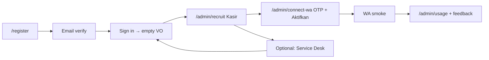

# F3-3 — Pilot 3–5 real stores (design)

**Status:** Design locked for pilot execution · **Backlog:** F3-3 · **Owner:** PO-NS3  
**Updated:** 2026-10-15  
**Code baseline:** `master` @ **`a122ab8`** (F3-1 Service Desk merged [#61](https://github.com/nusantarasoft/nusantarasoft-3/pull/61); F3-2 usage [#60](https://github.com/nusantarasoft/nusantarasoft-3/pull/60))

**Scope:** Run a **controlled pilot** with **3–5 real UMKM stores** on the shipped F2 wedge (register → recruit → connect WA) plus **optional** second agent (F3-1 Service Desk). Capture honest feedback and file fixes as backlog items — **not** F3-4 pricing, **not** net-new product unless a gap blocks minimal pilot (see §6).

Related: [f2-1-tenant-onboarding.md](f2-1-tenant-onboarding.md), [f2-2-agent-catalog-recruit.md](f2-2-agent-catalog-recruit.md), [f2-3-tenant-wa-connection.md](f2-3-tenant-wa-connection.md), [f3-1-service-desk-recruit.md](f3-1-service-desk-recruit.md), [f3-2-usage-metrics.md](f3-2-usage-metrics.md), ops [f3-3-pilot-runbook.md](../ops/f3-3-pilot-runbook.md).

---

## 1. Goals

| Goal | Rationale |
|------|-----------|
| Prove **owner self-serve** works for real people (not QA fixtures) | F2-1..F2-4 + F3-1/F3-2 are merged on `master` but **not** validated with live merchants at scale |
| Validate **Kasir WA** on shared NS inbox with real customer/staff numbers | Core wedge; outbound gate depends on F2-3 OTP + Aktifkan |
| Learn whether owners want **Service Desk** (F3-1) in the same trial | Second SKU is live; pilot makes recruit optional per store |
| Produce **actionable findings** (bugs, copy, ops friction) before F3-4 pricing | PO/Akbar decide pricing; pilot feeds backlog only |

---

## 2. Success metrics

Measured at **pilot close** (target: within **14 calendar days** of first store live, PO may extend):

| Metric | Target | How to verify |
|--------|--------|----------------|
| Stores enrolled | **3–5** | PO roster + `tenant_stores` / slug aliases |
| End-to-end onboarding | **≥ 80%** of enrolled stores complete §4 flow | Runbook checklist signed per store |
| Kasir WA smoke | **100%** of Kasir-recruited stores pass §5 smoke | Owner + ops witness; log in pilot sheet |
| Time to first useful WA reply | **< 30 min** from Aktifkan to inbound test message answered | Timestamp in runbook |
| Critical blockers | **0** open P0 at pilot close | PO triage; items in backlog **Discovered** |
| Feedback captured | **≥ 1 structured debrief** per store | PO template (§7) |

**Non-goals for this pilot:** revenue, subscription tiers, dedicated WA numbers (P2-5 opt-in is **out of pilot default** unless Akbar explicitly enables for one store).

---

## 3. Store selection

PO selects **3–5** stores with Akbar. Prefer diversity without exploding scope:

| Criterion | Guidance |
|-----------|----------|
| Relationship | Willing to tolerate rough edges; reachable on WA for OTP and smoke |
| Business type | Warung / small retail / F&B — matches Kasir kurikulum |
| Channel | Owner has a **stable mobile** for OTP; staff numbers for whitelist (≤ 5) |
| Technical | Can receive **email verification** at a real inbox |
| Exclusions | No production secrets in chat; no stores requiring dedicated WA on day one |

**Pilot roster (fill before go-live):**

| # | Display name | Owner email | Owner phone (OTP) | Staff WA (whitelist) | Notes |
|---|--------------|-------------|-------------------|------------------------|-------|
| P1 | _PO fills_ | | | | |
| P2 | | | | | |
| P3 | | | | | |
| P4 | optional | | | | |
| P5 | optional | | | | |

Akbar / platform ops pre-provision: **shared Hermes inbox** paired ([f2-3-connect-wa-flow.md](../ops/f2-3-connect-wa-flow.md)); no per-store QR for v1 default.

---

## 4. Onboarding flow (happy path)

Single narrative for owners; ops runbook has step-by-step commands.

| Step | Owner action | System expectation |
|------|--------------|-------------------|
| 1. Register | `/register` — business name, email, password, captcha | `registerTenant` succeeds; **no JWT** until email confirmed ([F2-1](../design/f2-1-tenant-onboarding.md)) |
| 2. Verify email | Click link in inbox | `ENABLE_EMAIL_AUTOCONFIRM=false` in prod |
| 3. Sign in | `/login` | JWT; Virtual Office **empty floor** + recruit CTA |
| 4. Recruit Kasir | `/admin/recruit` → **Rekrut sekarang** | Redirect `/admin/connect-wa`; Kasir on VO roster ([F2-2](../ops/f2-2-recruit-flow.md)) |
| 5. Connect WA | Owner phone → OTP (real WA in prod) → staff whitelist → **Aktifkan** | **WA terhubung**; outbound gate open ([F2-3](../ops/f2-3-connect-wa-flow.md)) |
| 6. Optional Service Desk | `/admin/recruit` → Service Desk | Agent on VO; `/admin/itsm/*` — **no WA required** ([F3-1](../ops/f3-1-recruit-flow.md)) |
| 7. Smoke | Send test WA as whitelisted staff/customer pattern | Kasir replies; task visible in AOS queue (F1-3) |
| 8. Observe usage | `/admin/usage` (7-day window) | Live metrics ([F3-2](f3-2-usage-metrics.md)) |

**Alternate path (discouraged for pilot):** legacy WA **DAFTAR** + admin approve queue — only if PO explicitly chooses; web register is the pilot default.

---

## 5. Smoke test (minimal)

After **Aktifkan**, within the same session where possible:

| # | Check | Pass |
|---|--------|------|
| S1 | `/admin/connect-wa` shows connected state | Owner sees **WA terhubung** |
| S2 | Whitelisted staff number sends **structured kasir message** (e.g. sale or `bantuan`) | Inbound handled; no silent drop |
| S3 | Virtual Office shows Kasir agent **Live** (not Demo) | F1-4 badges |
| S4 | Agentic OS task queue shows activity from Kasir | F1-3 |
| S5 | (If Service Desk recruited) `/admin/itsm/tickets` loads | No demo-only banner on recruited agent |

Reference E2E (QA stack only): `f2-1-onboarding`, `f2-2-recruit-fullstack`, `f2-3-connect-wa-fullstack`, `f3-1-service-desk-recruit` under `admin/tests/e2e/`.

---

## 6. Known blockers & environment gates

### 6.1 Production self-serve (F2 prod readiness)

Public **`/register`** and production OTP **must not** go live for the pilot until the combined F2 gate is green:

**[docs/ops/release-f2-prod-readiness.md](../ops/release-f2-prod-readiness.md)**

| Blocker | Why it matters for pilot |
|---------|---------------------------|
| **Turnstile** (`TURNSTILE_*` / captcha) | Middleware **fail-closed** in prod without valid captcha config |
| **SMTP + `ENABLE_EMAIL_AUTOCONFIRM=false`** | Owners cannot complete signup without real mail |
| **`WA_OTP_SECRET`**, no **`WA_OTP_MOCK`** | Connect-WA OTP must reach owner on shared Hermes line |
| **DB migrations** §3 in release doc | `tenant_stores`, WA connection columns, etc. |
| **Akbar deploy approval** | F2 wedge on `master` @ `4800eba+`; pilot target includes F3-1/F3-2 @ `a122ab8` — deploy runbook separate |

**Pilot options if prod gate is not green:**

1. **Preferred:** Delay pilot start until deploy + §5 smoke on staging/prod per Akbar.
2. **PO-approved staging:** Same flows on QA stack with `CAPTCHA_DISABLED`, `WA_OTP_MOCK` — label results **staging-only**, not production proof.

### 6.2 Operational limitations (accept for v1)

| Limitation | Impact | Mitigation |
|------------|--------|------------|
| Pending OTP **in-memory** | Middleware restart drops in-flight OTP | Retry OTP; avoid redeploy mid-connect ([f2-3-connect-wa-flow.md](../ops/f2-3-connect-wa-flow.md)) |
| **Shared inbox** default | All pilot stores share one NS WA number | Whitelist discipline; clear owner comms |
| P2-5 **dedicated WA** | Optional; Hermes multi-session not default in prod compose | Do **not** enable for pilot unless ops runbook [p2-5-dedicated-wa.md](../ops/p2-5-dedicated-wa.md) explicitly green |

### 6.3 Code gaps → follow-up PRs (docs-only in F3-3)

| ID | Gap | Recommendation |
|----|-----|----------------|
| **F3-3-FU-1** | [release-f2-prod-readiness.md](../ops/release-f2-prod-readiness.md) §5 smoke stops at F2-3; no F3-1 Service Desk / F3-2 usage rows | **Follow-up doc PR** extend §5 after pilot deploy SHA |
| **F3-3-FU-2** | Backlog **D-4** / **D-5** (Klontong prod verify, post-deploy audit browser) | Ops tasks before mixing legacy Klontong with new pilot tenants |
| **F3-3-FU-3** | No in-app “pilot feedback” form | Use PO debrief template (§7) + GitHub/Notion as PO prefers |

No code change required to **start** pilot design; ship code only if a gap is trivial and passes full QA gate.

---

## 7. Feedback loop

| When | Who | Artifact |
|------|-----|----------|
| During connect | Ops shadows owner (screen share or WA) | Runbook checklist ticks + timestamps |
| Day 1–3 | Owner uses Kasir naturally | PO collects: what worked / confusing / broken |
| Day 7 | PO debrief call or WA thread | **5 questions:** (1) register friction (2) recruit clarity (3) OTP/WA (4) Kasir usefulness (5) would they recruit Service Desk |
| End of pilot | PO + Akbar | Consolidate **Discovered** items in [backlog.md](../backlog.md); prioritize fixes before F3-4 |

Severity:

- **P0** — cannot complete onboarding or WA unsafe → stop store, hotfix path
- **P1** — completes flow but wrong/fragile behavior → backlog + target fix before scaling
- **P2** — copy/UX polish → backlog

---

## 8. Out of scope

- F3-4 pricing, plans, payment
- New agent SKUs (pembukuan, CS, stok)
- Replacing Hermes/kasir-pipe architecture
- Mandatory dedicated WA (P2-5) for all pilot stores

---

## 9. References

| Doc | Use |
|-----|-----|
| [release-f2-prod-readiness.md](../ops/release-f2-prod-readiness.md) | Prod gate before public signup |
| [f3-3-pilot-runbook.md](../ops/f3-3-pilot-runbook.md) | Per-store execution |
| [backlog.md](../backlog.md) | F3-3 done criteria + Discovered |
