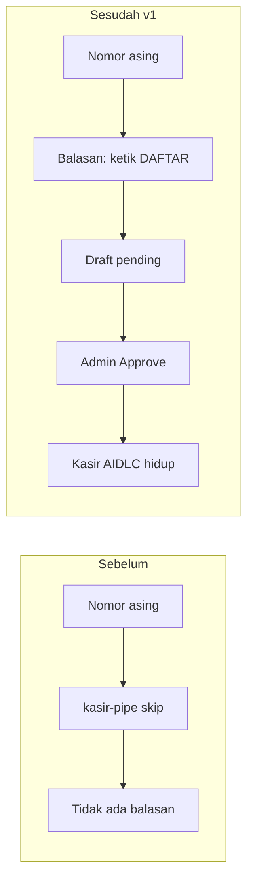
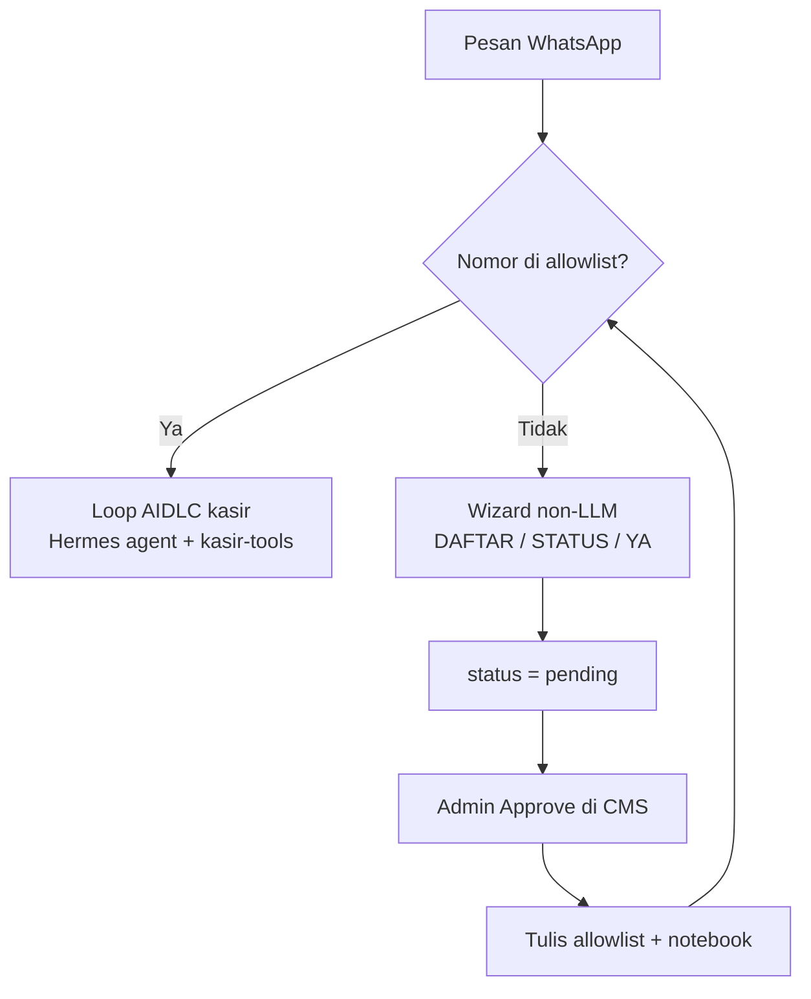
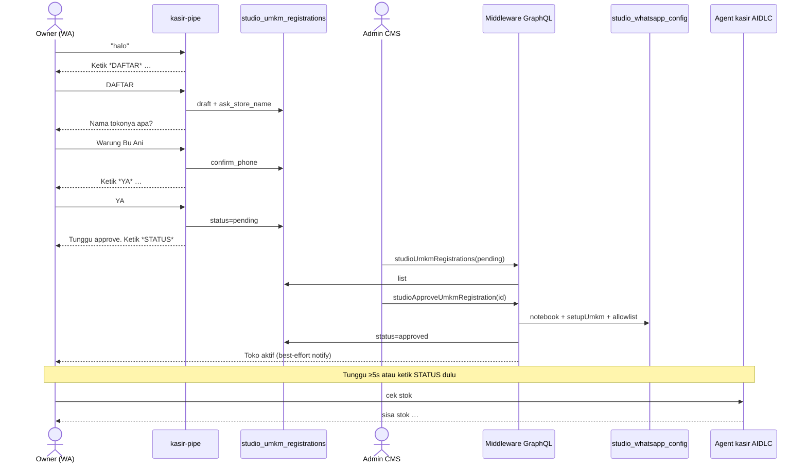
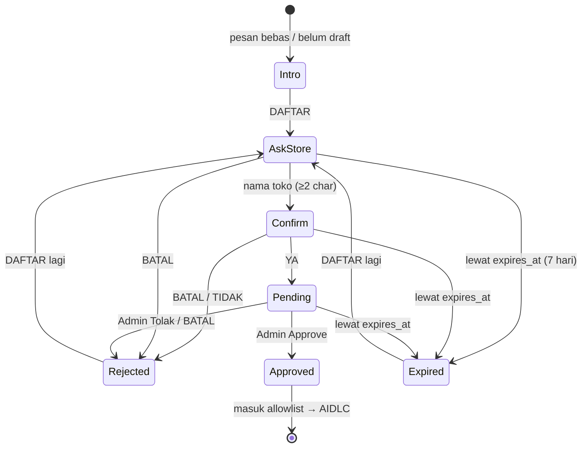
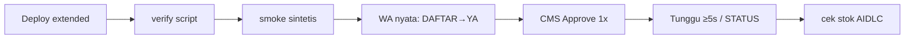

# AI Studio — UMKM WA: konsep bisnis, AIDLC, dan jalur trial

Date: 2026-09-19  
Status: **CEO SCOPE REDUCTION locked** (siap implementasi T1–T7)  
Parent design: [umkm-wa-register-admin-approve.md](./umkm-wa-register-admin-approve.md)  
Related: [middleware/STUDIO_UMKM.md](../../middleware/STUDIO_UMKM.md) (AIDLC kasir)

Dokumen ini mematenkan hasil `/plan-ceo-review`: apa yang kita jual secara bisnis, bagaimana itu menempel ke **AIDLC**, dan jalur **seminimal** untuk uji coba satu tenant.

---

## 1. Konsep bisnis (satu kalimat)

Pemilik warung chat ke nomor bisnis → ketik **DAFTAR** → admin setujui di AI Studio → nomor masuk allowlist → baru boleh pakai **kasir WhatsApp** (catat jual, cek stok, laporan).

Tanpa langkah itu, nomor asing dulu di-skip diam-diam (bot “mati”). Funnel ini mengganti silent-drop dengan onboarding yang jelas, tanpa OTP/bayar di v1.



**Nilai uji coba sukses:** satu nomor nyata bisa `cek stok` setelah Approve — bukan hanya smoke sintetis hijau.

---

## 2. Di mana ini di peta AI Studio

```
AI Studio (Admin CMS)
├── Studio notebook RAG          ← knowledge / NotebookLM
├── Settings / Gateway           ← provider, pair WA
└── UMKM  /admin/ai-studio/umkm  ← tenant kasir WA  ★ dokumen ini
        ├── Form "Tambah UMKM"     (admin provision — jalur lama)
        └── Antrian "Menunggu approve"  (self-serve DAFTAR — jalur baru)
```

Self-serve **bukan** mengganti form admin; keduanya menghasilkan `studio_whatsapp_config` + notebook UMKM. Trial REDUCTION menguji jalur **DAFTAR**, karena itu janji produk yang baru.

---

## 3. AIDLC — apa artinya di sini

**AIDLC** (AI Development Life Cycle) di modul UMKM = siklus percakapan kasir:

```
pahami pesan → routing intent → preview konfirmasi → commit → evaluasi
```

Contoh setelah toko aktif:

| Pesan owner | AIDLC |
|-------------|--------|
| `jual 2 indomie` | intent `record_sale` → preview → `ya` → tulis `ecom_orders` |
| `cek stok` | intent `check_stock` → baca ledger → balasan |
| `laporan` / omzet | intent `sales_report` → view penjualan |

Funnel **DAFTAR** berada **sebelum** AIDLC:



Kenapa wizard tidak pakai LLM: hemat biaya, state machine jelas, hindari jailbreak tool sebelum tenant resmi.

---

## 4. Alur end-to-end (owner + admin)



---

## 5. State machine pendaftaran (wizard)



Unique partial index: satu nomor hanya boleh punya satu baris open (`draft` | `pending`) pada satu waktu.

---

## 6. Gate allowlist (inti teknis)

```
                    pre_gateway_dispatch
                            │
              ┌─────────────┴─────────────┐
              │  _sender_allowed(phone)?  │
              └─────────────┬─────────────┘
                     yes │         │ no
                         ▼         ▼
                   Hermes agent   KASIR_REGISTRATION?
                   (AIDLC)              │
                                   0 → silent skip (rollback)
                                   1 → wizard registration
                                         lalu action=skip
                                         (LLM tidak jalan)
```

Allowlist di-cache di pipe (default 30s). Untuk trial: **`KASIR_ALLOWLIST_CACHE_SEC=5`**. Setelah Approve, owner menunggu **≥5 detik** atau ketik **STATUS** sebelum `cek stok` (hindari false-deny).

---

## 7. Keputusan CEO review (SCOPE REDUCTION) — locked

| ID | Keputusan |
|----|-----------|
| Mode | **SCOPE REDUCTION** — seminimal ke satu tenant hidup |
| Approach | **B** — deploy funnel coded (bukan hanya form admin) |
| D4 | Env `KASIR_ALLOWLIST_CACHE_SEC=5` |
| D5 | Approve non-atomik diterima + runbook (satu klik Approve) |
| D6 | Fallback balasan WA jika outer `except` di pipe |
| D7 | UI pending: tampilkan error load (jangan `.catch(() => [])`) |
| D8 | RLS on `studio_umkm_registrations`; service_role; **no GRANT anon** |
| D9 | Bukti tenant = **manual E2E** satu nomor (smoke tetap tanpa Approve) |
| D10 | Satu lap: extend `deploy-umkm-registration.py` |
| D11 | `approve()` menolak jika `expires_at` lewat |
| D12 | Checklist: tunggu ≥5s / STATUS setelah Approve |
| D13 | Admin WA ping **tidak** masuk TODO sekarang |

### NOT in scope (v1 / trial)

- Admin WA ping saat pending  
- OTP / payment  
- Multi-toko per nomor  
- Forward chat kasir ke middleware webhook  
- Wizard LLM  
- Saga transaksi Approve  
- Smoke auto-approve  
- Cache-bust kode saat Approve  
- Cathedral metrics  

### Rollback

```bash
# di env Hermes / .env.master-production
KASIR_REGISTRATION=0
```

Nomor asing kembali silent-skip; tenant yang sudah di allowlist tetap jalan.

---

## 8. Jalur trial (checklist operasional)

Urutan wajib:



### Langkah detail

1. **Deploy** — `python scripts/master-production/deploy-umkm-registration.py`  
   (setelah T1–T5: TTL=5, RLS, patch pipe/UI/approve, rebuild).
2. **Verify** — `verify-umkm-reg-deploy.py`  
   (`register.py` ada, `KASIR_REGISTRATION=1`, pair, table).
3. **Smoke** — `smoke-umkm-registration.py`  
   (wizard + pending + reject sintetis; **tanpa** Approve).
4. **WA nyata** — nomor belum allowlist:  
   `halo` → lihat hint DAFTAR → `DAFTAR` → nama toko → `YA`.
5. **CMS** — `/admin/ai-studio/umkm` → **Menunggu approve** → Approve **sekali**.  
   Jika error: cek list UMKM + row registration (hindari orphan ganda).
6. **Stabilisasi allowlist** — tunggu ≥5s atau ketik `STATUS` (harus “Toko aktif…”).
7. **AIDLC** — `cek stok` (atau `laporan`). Sukses = trial hijau.
8. **Opsional rollback** — `KASIR_REGISTRATION=0`, nomor asing lagi silent; nomor approved tetap kasir.

### Kriteria lulus

| # | Kriteria |
|---|----------|
| 1 | Nomor asing dapat balasan menyebut DAFTAR (bukan diam) |
| 2 | YA → row `pending` muncul di CMS (atau error toast jika API gagal) |
| 3 | Approve → config enabled + phone allowlist; registration `approved` |
| 4 | Setelah wait, `cek stok` dijawab agent kasir (bukan intro DAFTAR) |
| 5 | `KASIR_REGISTRATION=0` mengembalikan silent-skip untuk nomor asing |

---

## 9. Implementation tasks (dari review)

| ID | Kerjaan | Area |
|----|---------|------|
| T1 | Fallback WA pada outer except + test | `kasir-pipe/__init__.py` |
| T2 | Surface error load pending | `admin/.../umkm/page.tsx` |
| T3 | Migration RLS + hilangkan GRANT anon di hotfix | `supabase/migrations` |
| T4 | `approve()` guard `expires_at` | `studio-umkm-registration.service.ts` |
| T5 | Extend deploy script (TTL, RLS, patches) | `deploy-umkm-registration.py` |
| T6 | Dokumen ini = runbook (checklist §8) | `docs/designs/` |
| T7 | Jalankan deploy → verify → smoke → E2E §8 | ops |

Paralel: T1–T4 → lalu T5 → T7. T6 = dokumen ini.

---

## 10. Referensi kode

| Layer | Path |
|-------|------|
| Wizard murni | `scripts/master-production/hermes-plugins/kasir-pipe/register.py` |
| Gate + REST | `scripts/master-production/hermes-plugins/kasir-pipe/__init__.py` |
| Approve/reject | `middleware/src/studio/studio-umkm-registration.service.ts` |
| GraphQL | `middleware/src/studio/studio.resolver.ts` |
| Admin UI | `admin/src/app/admin/ai-studio/umkm/page.tsx` |
| Schema | `supabase/migrations/00000000000104_studio_umkm_registrations.sql` |
| Deploy / smoke | `scripts/master-production/deploy-umkm-registration.py`, `smoke-umkm-registration.py` |

---

## 11. Riwayat

| Tanggal | Catatan |
|---------|---------|
| 2026-09-12 | Design parent IMPLEMENTED (code) |
| 2026-09-19 | `/plan-ceo-review` SCOPE REDUCTION; dokumen trial + AIDLC ini |
