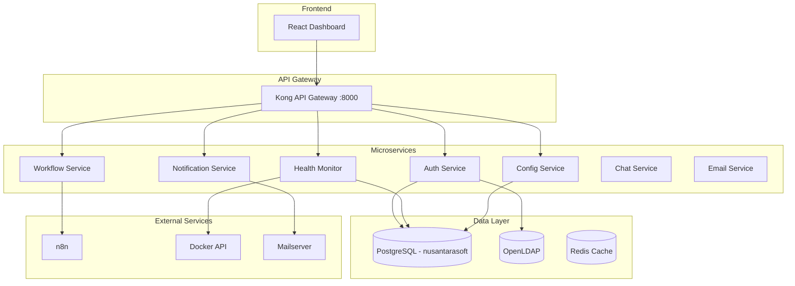

# Nusantarasoft Tech Stack Management Application

A microservices application to centrally manage, monitor, and orchestrate all services in the Nusantarasoft infrastructure.

---

## 🎯 Objectives

1. **Unified Dashboard** - Single pane of glass for all services
2. **Service Health Monitoring** - Real-time status of all containers
3. **User Management** - LDAP-integrated user/role management
4. **Automation Hub** - Trigger n8n workflows from the dashboard
5. **Configuration Management** - Manage service configs centrally
6. **Analytics & Reporting** - Use Dremio/Supabase for insights\r\n\r\n> [!IMPORTANT]\r\n> **All database access MUST go through Supabase APIs** (REST API, Realtime, Edge Functions).\r\n> Never use direct PostgreSQL connections. This ensures RLS policies are enforced.

---

## 🏗️ Architecture



---

## 📦 Microservices

### 1. Auth Service
**Purpose**: Authentication & user management via LDAP

| Endpoint | Method | Description |
|----------|--------|-------------|
| `/auth/login` | POST | Login with LDAP credentials |
| `/auth/logout` | POST | Logout user |
| `/auth/me` | GET | Get current user profile |
| `/auth/users` | GET | List all users (admin) |
| `/auth/roles` | GET | List roles |

**Tech**: Node.js + Express + ldapjs

---

### 2. Health Monitor Service
**Purpose**: Monitor Docker container health and service status

| Endpoint | Method | Description |
|----------|--------|-------------|
| `/health/services` | GET | List all services with status |
| `/health/services/:name` | GET | Get specific service detail |
| `/health/services/:name/restart` | POST | Restart a service |
| `/health/services/:name/logs` | GET | Get service logs |
| `/health/metrics` | GET | Get system metrics |

**Tech**: Node.js + dockerode (Docker API client)

---

### 3. Config Service
**Purpose**: Manage service configurations

| Endpoint | Method | Description |
|----------|--------|-------------|
| `/config/services` | GET | List configurable services |
| `/config/services/:name` | GET | Get service config |
| `/config/services/:name` | PUT | Update service config |
| `/config/env` | GET | Get environment variables |

**Tech**: Node.js + file system access

---

### 4. Workflow Service
**Purpose**: Integrate with n8n for automation

| Endpoint | Method | Description |
|----------|--------|-------------|
| `/workflows` | GET | List n8n workflows |
| `/workflows/:id` | GET | Get workflow details |
| `/workflows/:id/execute` | POST | Trigger workflow execution |
| `/workflows/:id/executions` | GET | Get execution history |

**Tech**: Node.js + n8n API client

---

### 5. Notification Service
**Purpose**: Send notifications via email/webhook

| Endpoint | Method | Description |
|----------|--------|-------------|
| `/notify/email` | POST | Send email notification |
| `/notify/webhook` | POST | Send webhook notification |
| `/notify/templates` | GET | List notification templates |

**Tech**: Node.js + nodemailer

---

### 6. Chat Service
**Purpose**: Real-time team messaging (Mattermost integration)

| Endpoint | Method | Description |
|----------|--------|-------------|
| `/chat/channels` | GET | List chat channels |
| `/chat/channels/:id/messages` | GET | Get channel messages |
| `/chat/channels/:id/messages` | POST | Send message to channel |
| `/chat/direct/:userId` | GET | Get direct messages |
| `/chat/direct/:userId` | POST | Send direct message |
| `/chat/users` | GET | List online users |

**Tech**: Node.js + WebSocket + Mattermost API

---

### 7. Email Service
**Purpose**: Email management (mailserver integration)

| Endpoint | Method | Description |
|----------|--------|-------------|
| `/email/inbox` | GET | Get inbox emails |
| `/email/sent` | GET | Get sent emails |
| `/email/compose` | POST | Send new email |
| `/email/:id` | GET | Get email details |
| `/email/:id` | DELETE | Delete email |
| `/email/:id/read` | PUT | Mark as read |
| `/email/accounts` | GET | List email accounts |

---

## 🗄️ Database Schema

### Tables (in `nusantarasoft` database)

```sql
-- Service registry
CREATE TABLE services (
    id UUID PRIMARY KEY DEFAULT gen_random_uuid(),
    name VARCHAR(100) UNIQUE NOT NULL,
    display_name VARCHAR(255),
    description TEXT,
    type VARCHAR(50), -- 'container', 'external', 'database'
    url VARCHAR(500),
    health_endpoint VARCHAR(255),
    is_active BOOLEAN DEFAULT true,
    created_at TIMESTAMPTZ DEFAULT NOW(),
    updated_at TIMESTAMPTZ DEFAULT NOW()
);

-- Service health logs
CREATE TABLE service_health_logs (
    id UUID PRIMARY KEY DEFAULT gen_random_uuid(),
    service_id UUID REFERENCES services(id),
    status VARCHAR(20), -- 'healthy', 'unhealthy', 'unknown'
    response_time_ms INTEGER,
    error_message TEXT,
    checked_at TIMESTAMPTZ DEFAULT NOW()
);

-- User sessions (for JWT tokens)
CREATE TABLE user_sessions (
    id UUID PRIMARY KEY DEFAULT gen_random_uuid(),
    ldap_dn VARCHAR(500) NOT NULL,
    username VARCHAR(100) NOT NULL,
    email VARCHAR(255),
    roles TEXT[],
    token_hash VARCHAR(255),
    expires_at TIMESTAMPTZ,
    created_at TIMESTAMPTZ DEFAULT NOW()
);

-- Audit logs
CREATE TABLE audit_logs (
    id UUID PRIMARY KEY DEFAULT gen_random_uuid(),
    user_id UUID,
    action VARCHAR(100) NOT NULL,
    resource_type VARCHAR(100),
    resource_id VARCHAR(255),
    details JSONB,
    ip_address INET,
    created_at TIMESTAMPTZ DEFAULT NOW()
);

-- Configuration snapshots
CREATE TABLE config_snapshots (
    id UUID PRIMARY KEY DEFAULT gen_random_uuid(),
    service_id UUID REFERENCES services(id),
    config_data JSONB NOT NULL,
    created_by UUID,
    created_at TIMESTAMPTZ DEFAULT NOW()
);
```

---

## 📁 Project Structure

```
apps/
├── management-api/              # Backend microservices
│   ├── src/
│   │   ├── services/
│   │   │   ├── auth/            # Auth service
│   │   │   ├── health/          # Health monitor
│   │   │   ├── config/          # Config service
│   │   │   ├── workflow/        # Workflow service
│   │   │   ├── notify/          # Notification service
│   │   │   ├── chat/            # Chat service (Mattermost)
│   │   │   └── email/           # Email service (mailserver)
│   │   ├── shared/              # Shared utilities
│   │   │   ├── db.ts            # Database connection
│   │   │   ├── ldap.ts          # LDAP client
│   │   │   └── docker.ts        # Docker client
│   │   └── index.ts             # Main entry
│   ├── Dockerfile
│   └── package.json
│
├── management-ui/               # Frontend dashboard
│   ├── src/
│   │   ├── components/
│   │   ├── pages/
│   │   ├── hooks/
│   │   └── lib/
│   ├── Dockerfile
│   └── package.json
│
└── docker-compose.management.yml  # Docker compose for management app
```

---

## 🚀 Implementation Phases

### Phase 1: Foundation (Week 1)
- [ ] Create project structure
- [ ] Set up database schema
- [ ] Implement Auth Service (LDAP login)
- [ ] Basic Health Monitor (container status)

### Phase 2: Core Services (Week 2)
- [ ] Complete Health Monitor (logs, restart)
- [ ] Implement Config Service
- [ ] Implement Workflow Service (n8n integration)
- [ ] Implement Notification Service

### Phase 3: Frontend Dashboard (Week 3)
- [ ] React app setup with Vite
- [ ] Login page with LDAP auth
- [ ] Dashboard overview
- [ ] Service management page
- [ ] Workflow management page

### Phase 4: Integration & Polish (Week 4)
- [ ] Docker compose integration
- [ ] Kong API Gateway routing
- [ ] Error handling & logging
- [ ] Security hardening
- [ ] Documentation

---

## 🔧 Technology Stack

| Component | Technology |
|-----------|------------|
| **Backend** | Supabase Edge Functions (Deno/TypeScript) |
| **Database** | Supabase PostgreSQL (`nusantarasoft` database) |
| **Auth** | Supabase Auth (LDAP via custom provider) |
| **Realtime** | Supabase Realtime (for Chat) |
| **Storage** | Supabase Storage (for attachments) |
| **Frontend** | React 18 + Vite + TailwindCSS |
| **API Client** | Supabase JS Client (@supabase/supabase-js) |
| **API Gateway** | Kong (existing) |
| **Workflow** | n8n API |

### Existing Database Assets
> [!NOTE]
> The **Email Service** uses the existing database schema from `volumes/db/emails.sql`:
> - `email_accounts` - User email accounts
> - `emails` - Email storage with RLS policies
> - `email_attachments` - Attachment metadata
> - Analytics views: `email_stats`, `email_volume_daily`, `top_senders`

---

## ✅ Verification Plan

### Automated Tests
```bash
# Run backend unit tests
cd apps/management-api
npm test

# Run frontend tests
cd apps/management-ui
npm test
```

### Manual Verification
1. **Auth Flow**: Login with LDAP credentials, verify JWT token works
2. **Health Monitor**: Check all services show correct status in dashboard
3. **Workflow Trigger**: Execute n8n workflow from dashboard
4. **Config Update**: Modify a service config and verify persistence

### Integration Test
```bash
# Start all services and verify endpoints
docker compose -f docker-compose.management.yml up -d
curl http://localhost:8000/management/health
curl http://localhost:8000/management/auth/me -H "Authorization: Bearer $TOKEN"
```

---

## 📋 User Review Required

> [!IMPORTANT]
> Please review and confirm the following before proceeding:

1. **Architecture**: Is the microservices architecture appropriate for your needs?
2. **Services**: Are these 5 microservices (Auth, Health, Config, Workflow, Notify) sufficient?
3. **Tech Stack**: Node.js + React - any preference for different technologies?
4. **Integration Priority**: Which service integration is most important to you first?
5. **Timeline**: Is the 4-week phased approach acceptable?

---

## 🔗 Related Files

- [README.md](file:///c:/Users/Adityo%20Nugroho/Documents/Nusantarasoft/Docker/nusantarasoft%203/README.md) - Main infrastructure docs
- [docker-compose.yml](file:///c:/Users/Adityo%20Nugroho/Documents/Nusantarasoft/Docker/nusantarasoft%203/docker-compose.yml) - Current services
- [.env](file:///c:/Users/Adityo%20Nugroho/Documents/Nusantarasoft/Docker/nusantarasoft%203/.env) - Environment configuration
