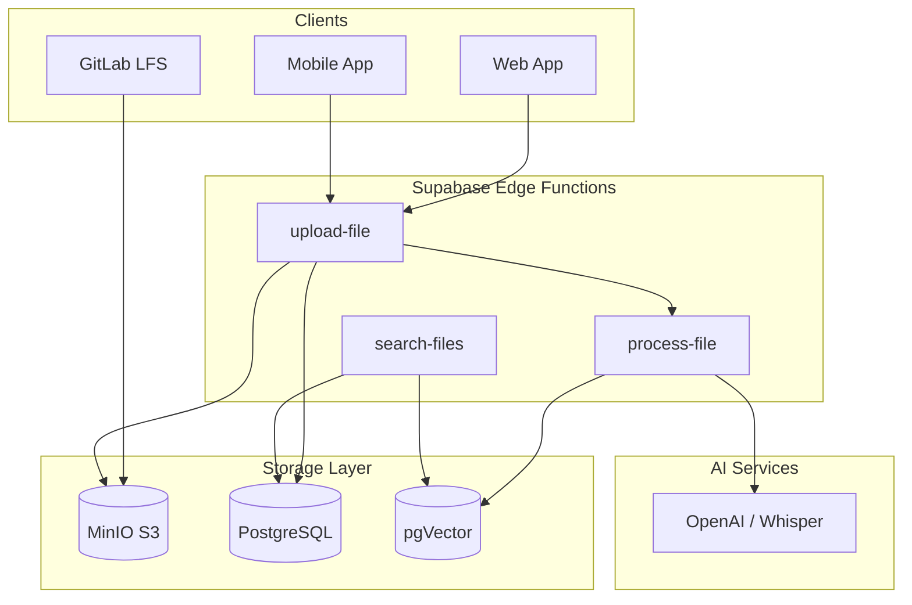

# Platform Services Guide: Email & File Storage

This unified documentation covers the architecture, deployment, and usage of the two core platform services: **File Storage (MinIO + pgVector + GitLab LFS)** and **Email System (Docker Mailserver + Supabase)**.

---

# 📂 Part 1: File Storage System

The file storage system uses **MinIO** as an S3-compatible backend, **PostgreSQL** for metadata, and **pgVector** for AI-powered semantic search.

## 1. System Architecture



## 2. Setup & Configuration

### Start Services
```bash
docker compose up -d minio storage postgres kong functions
```

### Initialize Storage Buckets
Use the MinIO client (`mc`) to create required buckets:

```bash
# Set MinIO alias
docker exec minio mc alias set local http://localhost:9000 admin minioadmin123!

# Create buckets
docker exec minio mc mb local/documents
docker exec minio mc mb local/images
docker exec minio mc mb local/audio
docker exec minio mc mb local/video
docker exec minio mc mb local/attachments
docker exec minio mc mb local/gitlab-lfs

# Make 'images' bucket public
docker exec minio mc anonymous set download local/images
```

### Enable Versioning for Rollback
```bash
docker exec minio mc version enable local/documents
docker exec minio mc version enable local/images
```

## 3. Usage Walkthrough

### 📤 Uploading Files
**Endpoint**: `POST /functions/v1/upload-file`

```bash
curl -X POST http://localhost:54321/functions/v1/upload-file \
  -H "Authorization: Bearer <jwt>" \
  -F "file=@/path/to/report.pdf" \
  -F "folder_id=optional-uuid" \
  -F "generate_embedding=true"
```

### 🔍 Semantic Search
Find files by meaning (e.g., "quarterly financial report") instead of exact keywords.

**Endpoint**: `POST /functions/v1/search-files`

```bash
curl -X POST http://localhost:54321/functions/v1/search-files \
  -H "Authorization: Bearer <jwt>" \
  -H "Content-Type: application/json" \
  -d '{
    "query": "quarterly financial report",
    "search_type": "semantic",
    "limit": 5
  }'
```

### ↺ Versioning & Rollback
**Restore a previous file version:**
```bash
# List versions
docker exec minio mc ls --versions local/documents/report.pdf

# Restore (Copy old version to current)
docker exec minio mc cp --version-id "OLD_VERSION_ID" local/documents/report.pdf local/documents/report.pdf
```

## 4. GitLab LFS Integration

Configure GitLab to store large files (LFS) in MinIO.

### Architecture
- **GitLab LFS**: Stores pointers in Git, blobs in MinIO `gitlab-lfs` bucket.
- **Artifacts**: CI/CD build outputs in `gitlab-artifacts`.
- **Uploads**: User uploads in `gitlab-uploads`.

### Setup LFS in Repo
```bash
git lfs install
git lfs track "*.mp4" "*.psd"
git add .gitattributes
git add large-video.mp4
git commit -m "Add video"
git push
```

### Rollback LFS
```bash
# Revert file to previous commit
git checkout HEAD~1 -- large-video.mp4
git commit -m "Revert video"
git push
```

---

# 📧 Part 2: Email System

A full-stack email solution using **Docker Mailserver** (Postfix/Dovecot), **Supabase** (for API/Storage), and **Roundcube** (Webmail).

## 1. Deployment Guide

### Prerequisites
- Domain `nusantarasoft.com`
- Port 25 open (check VPS provider)
- Reverse DNS (PTR) record set for `mail.nusantarasoft.com`

### Docker Service Config
Ensure `mailserver` service is configured in `docker-compose.yml`:
```yaml
mailserver:
  hostname: mail
  domainname: nusantarasoft.com
  ports:
    - "25:25"
    - "143:143"
    - "587:587"
    - "993:993"
```

### DNS Records
| Type | Name | Value | Purpose |
|------|------|-------|---------|
| A | mail | <VPS_IP> | Mail Server IP |
| MX | @ | mail.nusantarasoft.com | Mail Exchange |
| TXT | @ | `v=spf1 mx ip4:<VPS_IP> -all` | SPF (Anti-spoofing) |
| TXT | _dmarc | `v=DMARC1; p=quarantine` | DMARC policy |
| TXT | mail._domainkey | <DKIM_KEY> | DKIM Signature |

### Generate DKIM Keys
```bash
docker exec mailserver setup config dkim keysize 2048 domain nusantarasoft.com
# View key to add to DNS
docker exec mailserver cat /tmp/docker-mailserver/opendkim/keys/nusantarasoft.com/mail.txt
```

### Create Accounts
```bash
docker exec mailserver setup email add admin@nusantarasoft.com
docker exec mailserver setup email add info@nusantarasoft.com
```

## 2. Email API (Supabase)

### Database Schema (`emails` table)
| Column | Type | Description |
|--------|------|-------------|
| `from_address` | TEXT | Sender |
| `to_addresses` | JSONB | Recipients |
| `subject` | TEXT | Subject |
| `body_text` | TEXT | Plain text content |
| `folder` | TEXT | INBOX, SENT, etc. |

### Sending Email
**Endpoint**: `POST /functions/v1/send-email`

```javascript
const { data, error } = await supabase.functions.invoke('send-email', {
  body: {
    from: 'admin@nusantarasoft.com',
    to: ['client@example.com'],
    subject: 'Project Update',
    text: 'Here is the latest update...'
  }
});
```

### Receiving Email (Webhook)
Incoming emails are parsed and POSTed to `/functions/v1/receive-email`, which stores them in the `emails` table.

### Subscribe to New Emails
```javascript
supabase
  .channel('emails')
  .on('postgres_changes', 
    { event: 'INSERT', schema: 'public', table: 'emails' },
    (payload) => console.log('New email:', payload.new)
  )
  .subscribe();
```

---

## 🔗 Quick Links
- **Webmail**: `http://localhost:8082` (Roundcube)
- **MinIO Console**: `http://localhost:9001`
- **Supabase Studio**: `http://localhost:8000`
