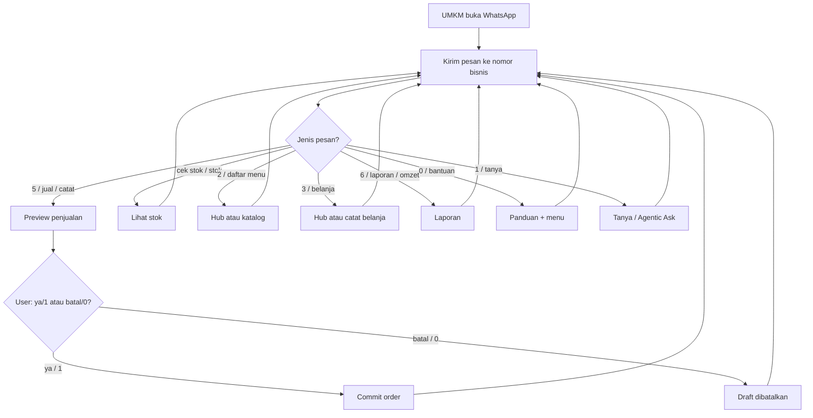
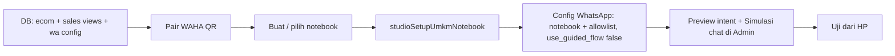
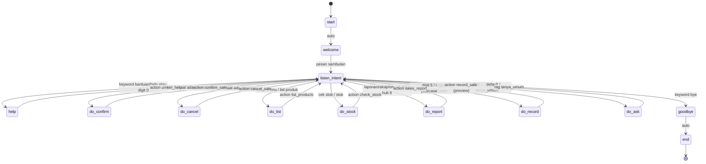
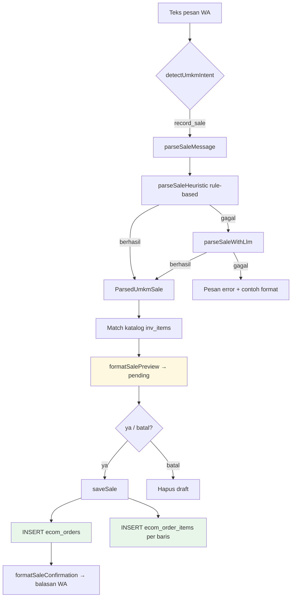
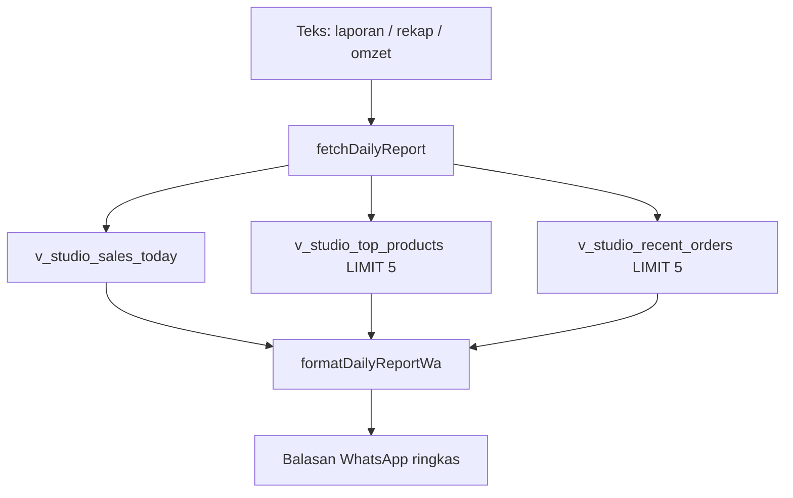
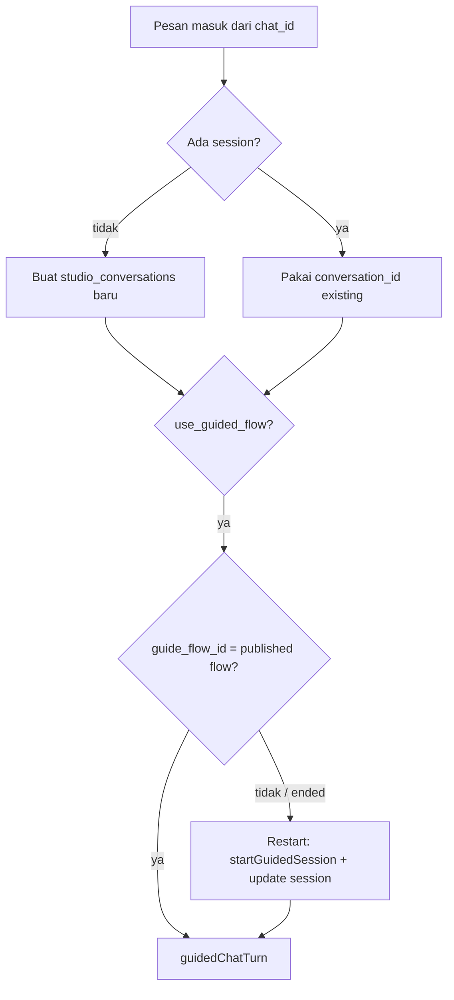
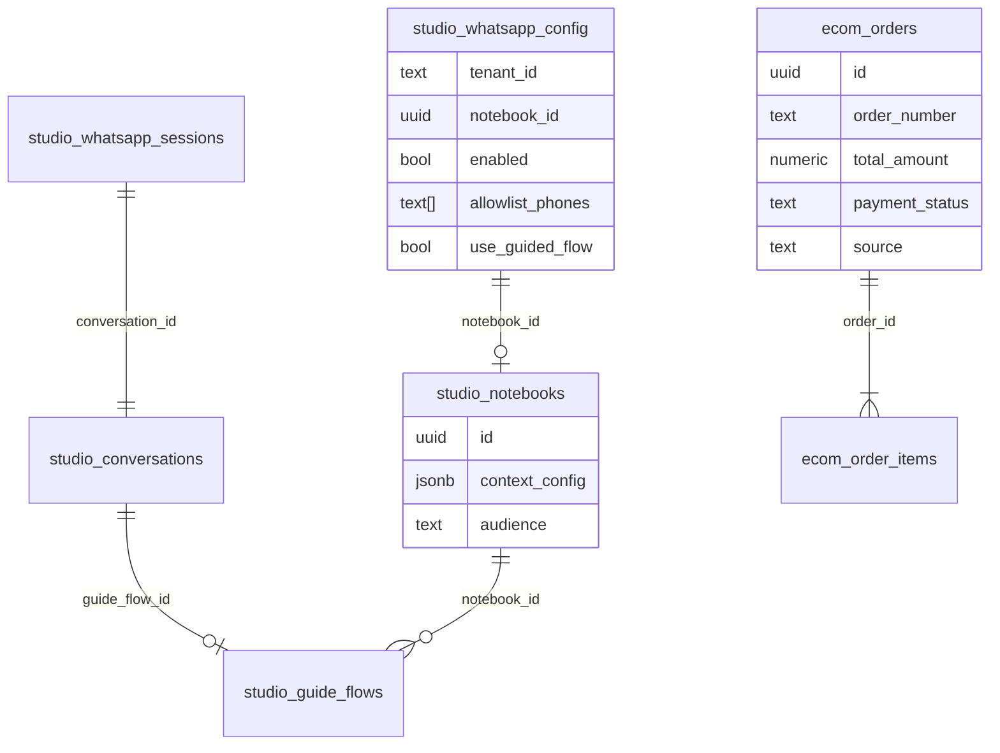
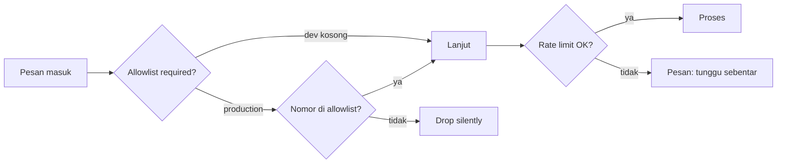
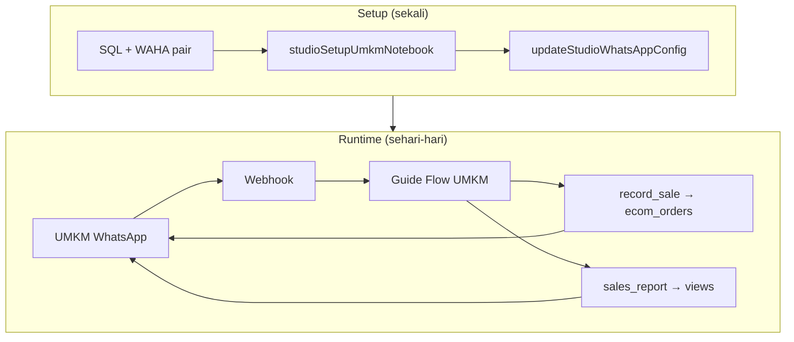

# AI Studio UMKM — Dokumen Alur & Flow

Dokumen ini menjelaskan **alur bisnis** (UMKM), **alur setup** (admin), dan **alur teknis** (sistem) untuk fitur catat penjualan & laporan via WhatsApp.

Dokumen terkait:
- [STUDIO_UMKM.md](./STUDIO_UMKM.md) — setup & konfigurasi
- [STUDIO_WHATSAPP.md](./STUDIO_WHATSAPP.md) — WAHA & webhook
- [STUDIO_GUIDED_CHAT.md](./STUDIO_GUIDED_CHAT.md) — guide flow umum

---

## 1. Ringkasan aktor

| Aktor | Peran |
|-------|-------|
| **UMKM** | Pemilik/staff toko; pakai WhatsApp sehari-hari |
| **Admin** | Setup sekali: notebook, WA, allowlist |
| **WAHA** | Jembatan WhatsApp Web ↔ HTTP API |
| **Middleware** | NestJS: webhook, guide flow, parsing, DB |
| **Postgres** | `ecom_orders` (tulis), `v_studio_sales_*` (baca) |

---

## 2. Alur bisnis (sudut pandang UMKM)

Default menu digit (`umkm_commands.menu`) — dapat diubah di Admin → UMKM:

| Digit | Intent | Label default |
|-------|--------|---------------|
| 0 | `help` | Bantuan |
| 1 | `ask` | Tanya |
| 2 | `menu_hub` | Menu (daftar / tambah / stok) |
| 3 | `purchase_hub` | Belanja |
| 4 | `list_sales` | Daftar penjualan |
| 5 | `record_sale` | Tambah penjualan |
| 6 | `report_hub` | Laporan |

Keyword bebas (contoh): `cek stok` → `check_stock`, `jual …` → `record_sale`, `laporan` → `sales_report`.



### Contoh percakapan

```
UMKM  → 0
Bot   → Menu angka 0–6 + contoh format

UMKM  → 5
Bot   → Prompt / alur tambah penjualan

UMKM  → jual 3 es kopi 45000 tunai
Bot   → 📋 Konfirmasi penjualan … Ketik ya / 1 atau batal / 0

UMKM  → 1
Bot   → ✅ Penjualan tercatat! No. order WA-... Total Rp 45.000

UMKM  → cek stok gula
Bot   → 📦 Cek Stok …

UMKM  → 6
Bot   → Hub laporan / ringkasan omzet
```

### Verifikasi perintah di Admin (preview + Sim)

Di **Admin → UMKM Penjualan WA → Edit**:

1. Atur digit menu / keyword (termasuk **Cek stok**).
2. **Preview perintah** — ketik contoh teks → **Cek intent** memanggil GraphQL `studioPreviewUmkmIntent` (matcher sama `detectUmkmIntent` di middleware).
3. **Coba di Simulasi** — Simpan dulu, lalu buka Simulasi chat dengan composer terisi (kirim manual). Pipeline sama inbound WA tanpa WAHA.

---

## 3. Alur setup (admin, sekali)



| Step | Apa yang terjadi | Output |
|------|------------------|--------|
| 1 | Jalankan SQL schema & view | Tabel `ecom_orders`, view `v_studio_sales_today` |
| 2 | Pair WAHA | Session `WORKING`, nomor bisnis aktif |
| 3 | Notebook AI Studio | UUID notebook |
| 4 | `studioSetupUmkmNotebook` | `umkm_mode: true` (default **tidak** publish Guide Flow) |
| 5 | `updateStudioWhatsAppConfig` | `enabled`, `allowlist_phones`, `use_guided_flow: false` |
| 6 | Admin: Preview intent + **Simulasi chat** (opsional) | Konfirmasi mapping perintah tanpa WAHA |
| 7 | Kirim `bantuan` / `0` dari HP | Welcome UMKM + menu |

---

## 4. Alur teknis — pesan masuk (inbound)

```mermaid
sequenceDiagram
    participant U as UMKM (HP)
    participant WA as WhatsApp
    participant WH as WAHA
    participant MW as StudioWhatsAppService
    participant GF as GuideFlowService
    participant UK as StudioUmkmService
    participant DB as Postgres

    U->>WA: kirim pesan
    WA->>WH: event message
    WH->>MW: POST /api/studio/whatsapp/webhook

    MW->>MW: cek enabled + notebook_id
    MW->>MW: cek allowlist + rate limit
    MW->>DB: resolveSession(chat_id → conversation_id)

    alt umkm_mode = true
        MW->>UK: handleMessage()
        UK->>DB: WRITE atau READ
        Note over MW: tanya/null ask → Agentic Ask; unknown → bantuan UMKM (bukan RAG)
    else use_guided_flow = true (bukan UMKM)
        MW->>GF: runGuidedTurn()
        GF->>GF: cek guide_flow_id vs published flow
        alt flow mismatch / belum bound
            GF->>GF: startGuidedSession (welcome)
        end
        GF->>UK: action node (record_sale / sales_report / umkm_help)
        UK->>DB: INSERT order atau SELECT views
        UK-->>GF: teks balasan
    else mode generik
        MW->>MW: StudioService.chat() RAG
    end

    MW->>WH: sendText (chunk ≤4000)
    WH->>WA: balasan
    WA->>U: terima pesan
```

### Routing keputusan di webhook

```
handleWebhook()
  ├─ config.enabled && notebook_id?  → lanjut / else stop
  ├─ allowlist + rate limit
  ├─ resolveSession(chat_id)
  └─ routing jawaban:
       ├─ umkm_mode=true           → handleMessage()      ← produk UMKM
       │     (tanya → Agentic Ask; unknown → bantuan; tidak pernah RAG)
       ├─ else use_guided_flow     → runGuidedTurn()      ← notebook generik / Gateway
       └─ lainnya                  → StudioService.chat()
```

---

## 5. Guide flow — UMKM Penjualan WA

Definisi: `defaultUmkmGuideFlowDefinition(commands?)` di `guide-flow.definition.ts`  
Nama published: **UMKM Penjualan WA** (AIDLC: preview → ya/batal → commit)  
Perintah (keyword + digit) dari `context_config.umkm_commands` — edit di Admin UMKM.

### Diagram state



### Node `listen_intent` — prioritas cabang

| Urutan | Kondisi | Target |
|--------|---------|--------|
| 1 | mengandung `bye` | `goodbye` |
| 2 | `bantuan`, `help`, `menu` | `help` |
| 3 | `ya` / `benar` / `ok` (ada pending) | `do_confirm` |
| 4 | `batal` / `tidak` (ada pending) | `do_cancel` |
| 5 | `daftar` / `katalog` / list produk | `do_list` |
| 6 | `cek stok` / `stok` | `do_stock` |
| 7 | `laporan`, `rekap`, `omzet` | `do_report` |
| 8 | regex `jual`, `jualan`, `catat`, `order`, `transaksi` | `do_record` |
| 9 | **default** / `tanya_umum` | `do_ask` (engine RAG — **tidak** dipakai saat `umkm_mode`) |

> **UMKM live (`umkm_mode`):** graph ini tidak dijalankan. Matcher D4.1 → `await_job_clarification` untuk job campur; unknown → bantuan string; tanya → Agentic Ask. Query Understanding **tidak** remap unknown→sale. Commit hanya setelah `ya`.

### Node `action` — eksekusi

| Node | Action | Service | Output |
|------|--------|---------|--------|
| `do_record` | `record_sale` | `prepareSaleFromText()` | Preview (pending) |
| `do_confirm` | `confirm_sale` | `commitPendingSale()` | Order tersimpan |
| `do_cancel` | `cancel_sale` | hapus pending | Draft dibatalkan |
| `do_stock` | `check_stock` | `buildStockCheckMessage()` | Qty stok |
| `do_list` | `list_products` | `buildProductListMessage()` | Katalog |
| `do_report` | `sales_report` | `buildDailyReportMessage()` | Template laporan WA |
| `help` | `umkm_help` | `formatUmkmHelp()` | Menu contoh |

---

## 6. Sub-alur — catat penjualan (WRITE)



### Field yang disimpan

| Tabel | Field penting |
|-------|---------------|
| `ecom_orders` | `order_number` (WA-YYYYMMDD-...), `total_amount`, `payment_status`, `source=api`, `status=completed` |
| `ecom_order_items` | `item_name`, `quantity`, `unit_price`, `subtotal` |

### Aturan pembayaran

- Pesan mengandung `tunai`, `transfer`, `qris`, dll. → `payment_status=paid`, `paid_amount=total`
- Tanpa kata pembayaran → `payment_status=unpaid`

### Format pesan yang didukung

```
jual 3 es kopi 45000
catat 2 tas total 500rb tunai
order pelanggan Budi 1 sabun 25000 transfer
```

Staging: pending di `guide_flow_context` (guided) atau memory per `tenant:phone` (TTL 15 menit).

---

## 7. Sub-alur — laporan penjualan (READ)



### Isi laporan

- Tanggal
- Jumlah order hari ini & yang lunas
- Omzet kotor & terbayar
- Produk terlaris (top 5, all-time dari view)
- Order terbaru (3 baris)

---

## 8. Alur sesi WhatsApp

Setiap `chat_id` WA dipetakan ke satu baris di `studio_whatsapp_sessions` → `studio_conversations`.

Graf di bawah **hanya** untuk notebook `umkm_mode=false` (AI Gateway / Guide Flow). Notebook UMKM tidak masuk cabang ini — inbound selalu `handleMessage()`.



### Reset sesi otomatis

Sesi di-restart (welcome ulang) jika:

1. `guide_flow_id` kosong (percakapan baru)
2. **Flow published berubah** (mis. dari "New guide flow" → "UMKM Penjualan WA")
3. Flow sudah `end` (`guide_flow_node_id` null)

Ini mencegah error: *"Conversation is not bound to this guide flow"*.

---

## 9. Model data (ringkas)



### `context_config` notebook UMKM

```json
{
  "umkm_mode": true,
  "tenant_id": "default",
  "audience": "customer",
  "supabase_views": [
    "v_studio_sales_today",
    "v_studio_sales_summary",
    "v_studio_top_products",
    "v_studio_recent_orders"
  ]
}
```

---

## 10. Mode operasi

| `umkm_mode` | `use_guided_flow` | Perilaku |
|-------------|-------------------|----------|
| `true` | * | UMKM branch (`handleMessage()`); null hanya ask → Agentic Ask; unknown = bantuan |
| `false` | `true` | Guide Flow (notebook generik / Gateway) |
| `false` | `false` | Chat RAG |

---

## 11. Keamanan dalam alur



- Production / `STUDIO_WHATSAPP_REQUIRE_ALLOWLIST=true` → allowlist wajib
- Default: 10 pesan/menit per nomor

---

## 12. File kode per tahap alur

| Tahap alur | File |
|------------|------|
| Webhook masuk | `studio-whatsapp.controller.ts` → `studio-whatsapp.service.ts` |
| Sesi & routing | `studio-whatsapp.service.ts` (`handleWebhook`, `runGuidedTurn`) |
| Guide flow runtime | `guide-flow.service.ts` (`runFlowDrain`, case `action`) |
| Definisi flow UMKM | `guide-flow.definition.ts` (`defaultUmkmGuideFlowDefinition`) |
| Intent & parsing | `studio-umkm.util.ts` |
| Simpan order & laporan | `studio-umkm.service.ts` |
| View penjualan | `middleware/sql/studio_sales_views.sql` |
| Setup notebook | `studio.resolver.ts` → `studioSetupUmkmNotebook` |

---

## 13. Troubleshooting alur

| Gejala | Titik alur yang gagal | Solusi |
|--------|----------------------|--------|
| Tidak ada balasan | Webhook / WAHA tidak WORKING | Cek dashboard WAHA, webhook URL |
| Drop tanpa balasan | Allowlist | Tambah nomor atau kosongkan di dev |
| Welcome lama (RAG) | Guide flow bukan UMKM | `studioSetupUmkmNotebook` + publish |
| Error "not bound to guide flow" | Sesi lama + flow baru | Kirim pesan lagi (auto-restart) atau hapus session |
| "belum bisa memahami penjualan" | Parsing `record_sale` | Gunakan format contoh; set `ANTHROPIC_API_KEY` |
| Laporan 0 | Belum ada order hari ini | Catat penjualan dulu |

---

## 14. Diagram end-to-end (satu gambar)


