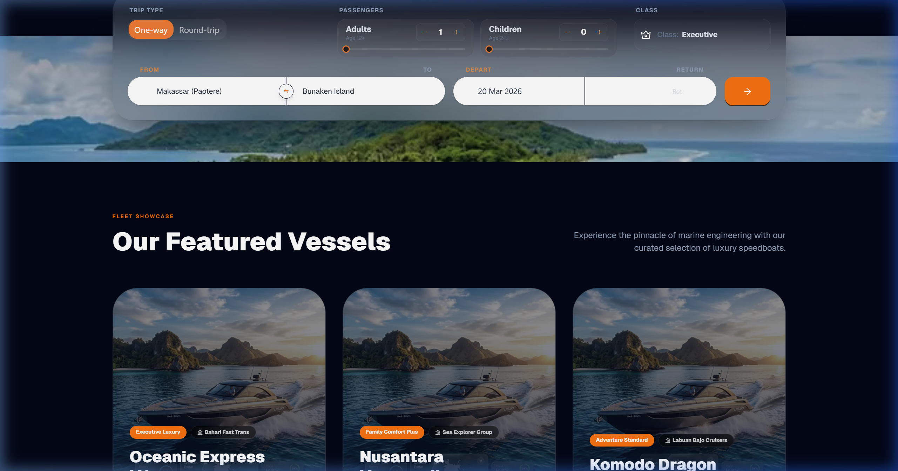
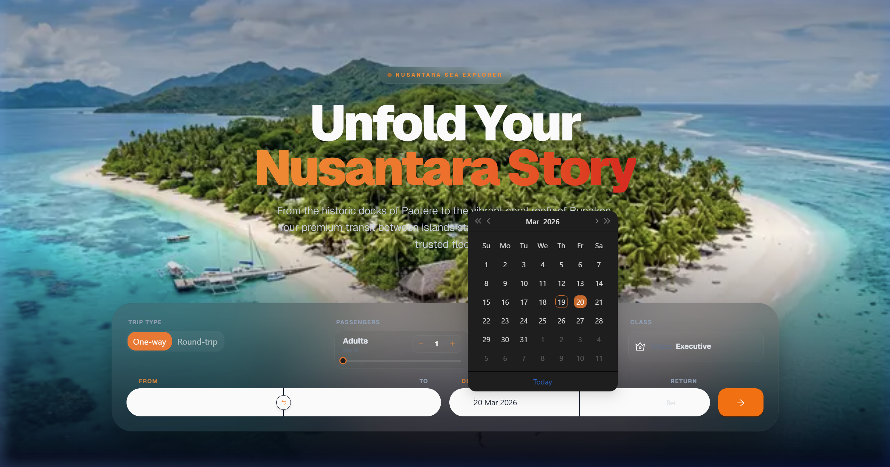
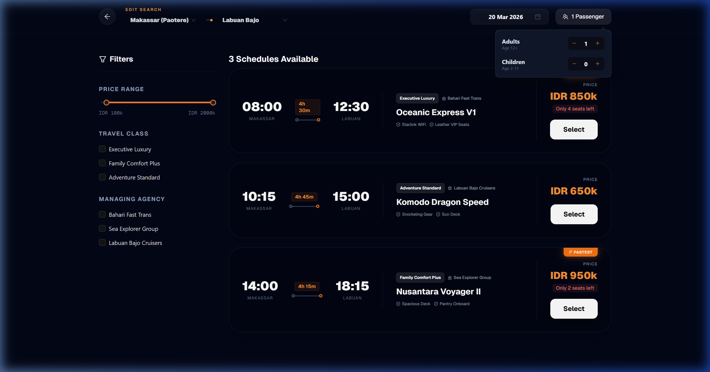
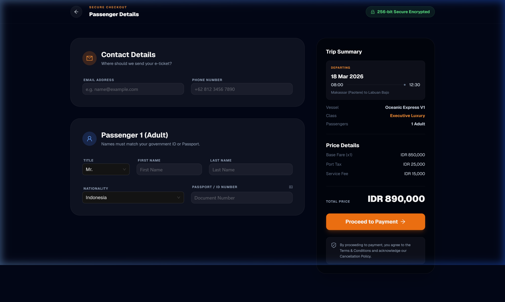

# 🚤 Panduan Penggunaan Modul Pemesanan Tiket Speedboat

Dokumen ini merupakan panduan praktis (Manual Guide) untuk penggunaan sistem **Nusantara Sea Explorer** khusus pada fitur pencarian dan pemesanan kapal cepat (Speedboat).

---

## 1. Widget Pemesanan pada Halaman Utama (Homepage)

Saat pelanggan membuka [Halaman Utama Speedboat](http://localhost:3000/speedboat), mereka akan langsung disambut oleh widget canggih yang berada di bagian Hero Section.

Pelanggan dapat menentukan:
- Aturan perjalanan ("One-way" atau "Round-trip").
- Mengatur rentang jumlah penumpang secara interaktif via Slider & input dinamis.
- Memilih kategori "Travel Class" dengan *pop-up* selektor kelas.
- "Origin" (Pelabuhan Asal) & "Destination" (Pelabuhan Tujuan) dari daftar Pelabuhan utama Nusantara.
- Mengatur penanggalan.

Berikut adalah antarmuka utama di mana nama pelabuhan dibuat sangat kontras dan terlihat jelas (*legible*) di atas panel putih modern:

---

## 2. Pemilihan Tanggal Tampilan Mode Gelap (Dark Mode Calendar)

Salah satu keunikan sistem pemesanan Nusantara adalah konsistensi *Dark Theme* yang eksklusif (Premium UI). Saat pengguna berinteraksi dengan kolom input **"Depart"** atau **"Return"**, sistem akan memunculkan sebuah kalender *pop-up*.
Kalender ini 100% menggunakan estetika moderen gelap sehingga menyatu dengan tema lautan malam, tanpa merusak nilai kontras layar input.

---

## 3. Modifikasi Parameter pada Halaman Pencarian

Saat pengguna mendapati **Halaman Pencarian**, pengguna tidak perlu lagi menekan tombol "Back" (Kembali) jika ingin mengubah parameter rutenya. 
Bagian navigasi atas (Header) berfungsi layaknya sebuah kontrol perintah transparan.

Saat memanipulasi jumlah penumpang atau tanggal, Anda cukup berinteraksi dengan menu dropdown elegan pada bar tajuk situs (Header). Tanggal menggunakan kendali *Date picker*, sedangkan kotak jumlah Penumpang dapat dibuka untuk mengatur angka spesifik **Dewasa** (Age 12+) serta jumlah **Anak-anak** (Age 2-11) dengan animasi yang mulus.

---

## 4. Formulir Checkout & Pembayaran Berkeamanan Tinggi

Setelah memilih jadwal keberangkatan, sistem otomatis membawa pelanggan ke Halaman Checkout berdesain kaca (*glassmorphism*). Halaman ini menjunjung tinggi standar otoritas kelautan, di mana calon penumpang wajib menyerahkan informasi legal.

**Data yang Diperlukan:**
- **Contact Details**: Digunakan untuk pengiriman E-Ticket (Email dan Nomor HP).
- **Passenger Identification**: Menghimpun Titipan/Gelar, Nama Lengkap, Kewarganegaraan, hingga Nomor Paspor atau Indentitas Diri Pelanggan.

Panel kanan (*Trip Summary*) menampilkan rincian tarif dasar, pajak pelabuhan, layan tambahan, serta tombol **"Proceed to Payment"** untuk menyelesaikan proses transaksi.

*(Disusun dan divalidasi oleh Sistem AI Nusantara)*
